# Data Dictionary — Telco NOC — Network Operations

_Generated from `model.mjs` by `docs/gen-docs.mjs` — the same declaration that creates the Kinetic forms and indexes, so this cannot drift from what is deployed._

## Conventions (apply to every entity)

- **Storage**: one Kinetic form per entity in kapp `telco-noc`; every value is stored as a string, typed and validated by the writer (ingest WebAPI, engine, server). Required fields are *also* enforced by the platform (`required: true` → 400 on submit).
- **Stable internal ID**: the entity's `<X> ID` field (prefixed, never reused, never changed). **Unique per tenant** via a unique index `[Tenant ID, <X> ID]` → a retried create returns `uniqueness_violation` instead of duplicating. The Kinetic submission UUID is an implementation detail and is never used as a business key.
- **External IDs**: `External IDs` JSON map (source → id) on inventory entities; the `identifiers` form is the authoritative cross-system mapping used by alarm resolution.
- **Tenant scope**: `Tenant ID` on every row; every index leads with it; KSL policy `NOC Same Tenant` = `values('Tenant ID') === identity('attribute:NOC Tenant')`.
- **Provenance** (inventory entities): `Source System`, `Last Seen At`, `Confidence` (0–1).
- **Timestamps**: UTC ISO-8601 with `Z`, second precision. Display converts to tenant timezone.
- **Audit**: every state change by a user, the engine, a workflow or the AI writes an `audit` row (append-only: `Submission Modification` = admins only). Timeline (`incident-updates`) is also append-only.
- **Retention** (tenant policy, pilot defaults): raw events 30 d · metrics 30 d · alarms 400 d · incidents, impacts, notifications, audit 7 y. Purge job is designed, not implemented (see roadmap).

## Entity index

| Domain | Entity (form slug) | Purpose | Owner / source of truth |
|---|---|---|---|
| Organization | **Tenants** (`tenants`) | Isolation boundary: one operator organization (or wholesale partner) whose data is invisible to other tenants. | Platform admin |
| Organization | **Resolver Teams** (`teams`) | Operator organization and resolver groups that own incidents, work and escalation. | NOC management |
| Organization | **On-Call Assignments** (`oncall`) | Who is on call for which team, role and region over which UTC interval. Drives assignment and escalation. | NOC management / WFM |
| Geography | **Regions & Markets** (`geo-areas`) | Region → Market hierarchy used for roll-ups, on-call routing and executive views. | Network planning (GIS) |
| Geography | **Sites** (`sites`) | A physical location (hub, CO, cell site, hut, customer premises) with address, coordinates and access/safety data for field work. | Network inventory + GIS |
| Network | **Network Resources** (`resources`) | Every physical, logical and virtual network resource — fiber spans, ROADMs, ports, wavelengths, OTN/Ethernet links, routers, interfaces, circuits, RAN nodes, cells, power plants, network functions, paths. One table, typed by Resource Type (TMF639-style Resource with specialization). | Network inventory (netinv-a) + discovery |
| Network | **Topology Relationships** (`relationships`) | Time-aware, provenance-carrying dependency edges. 'From' depends on 'To'. Includes resource→resource and service instance→resource edges so impact traversal is one graph. | Network + service inventory, reconciled |
| Network | **External Identifier Map** (`identifiers`) | Maps every identifier an OSS/BSS/monitoring system uses (NE:AID strings, hostnames+ifnames, vendor IDs, GIS IDs, billing IDs) to the stable internal ID. Alarm resource resolution reads only this table. | Reconciliation service |
| Services | **Service Offerings** (`offerings`) | Catalog of sellable services and their default SLA. | Product management |
| Services | **Service Instances** (`service-instances`) | A deployed, customer-facing (CFS) or resource-facing (RFS) service. CFS instances are what customers buy; they depend on resources via relationships. | Service inventory (svcinv) |
| Services | **Customer Subscriptions** (`subscriptions`) | Links a customer account to a service instance under a contract + SLA. Consumer RAN coverage is modelled as aggregate segment subscriptions (Subscriber Count), never individual subscribers. | BSS (billing) |
| Customers | **Customer Accounts** (`customers`) | Billing/relationship account. Carries segment, tier, public-safety flag and comms preferences used for audience selection. | CRM |
| Customers | **Customer Contacts** (`contacts`) | People to notify. PII — restricted visibility; masked in AI prompts and exports. | CRM |
| Customers | **SLAs** (`slas`) | Service level terms used to compute exposure, credits and breach ETA. | Product / legal |
| Telemetry | **Raw Alarm Events** (`raw-alarms`) | Immutable intake log: exactly one record per accepted source event (idempotency key), with the original payload for provenance and replay. | Ingest WebAPI (Kinetic workflow) |
| Telemetry | **Normalized Alarms** (`alarms`) | One record per alarm condition instance (fingerprint while active). Repeats increment Occurrence Count instead of creating records. | Ingest WebAPI + correlation engine |
| Telemetry | **Correlation Groups** (`correlation-groups`) | A set of alarms explained by one root resource failure, with the reasoning and evidence that produced it. | Correlation engine |
| Telemetry | **Metric Observations** (`metrics`) | Normalized KPI / probe samples used to confirm impact and verify customer service recovery. | Performance mgmt / probes |
| Operations | **Incidents** (`incidents`) | The operational response record. One per correlated failure, not per alarm. | NOC (Kinetic is system of record) |
| Operations | **Incident Timeline** (`incident-updates`) | Append-only timeline: state changes, assignments, escalations, runbook steps (runbook execution), field updates, comms, verification, AI suggestions and decisions. | NOC |
| Operations | **Runbooks** (`runbooks`) | Versioned diagnostic/restoration procedures matched to resource types and alarm types. | NOC engineering |
| Operations | **Problems & Known Errors** (`problems`) | Underlying cause across one or more incidents; becomes a Known Error when root cause + workaround are documented. | Problem management |
| Change | **Change Requests** (`changes`) | Planned work incl. maintenance window, risk and alarm suppression scope. Also records approval, deployment and rollback events in Timeline. | Change management (ticketing) |
| Field work | **Work Orders** (`work-orders`) | Actionable field work: where, what, access, safety, parts, completion criteria, evidence. Dispatch, assignment and site visit are tracked as states + timestamps on the order. | Workforce management (Kinetic in pilot) |
| Field work | **Parts Inventory** (`parts`) | Spares by depot, with reserved quantity (inventory reservation). Reservations are referenced from work order Parts JSON. | Logistics / ERP |
| Communications | **Impact Assessments** (`impacts`) | Per incident × service instance × subscription: the impact class, the evidence, the topology path used, SLA exposure and recovery state. | Impact engine |
| Communications | **Customer Notifications** (`notifications`) | A communication to an audience: draft → approval → delivery, with who approved and what was sent. | NOC comms / service owner |
| Governance | **Audit Events** (`audit`) | Who/what did what to which record, when and why — users, engine, workflows, integrations and AI. | Platform (append-only) |
| Governance | **Integration Sources** (`integrations`) | Every upstream/downstream system: mode, health, freshness. Drives the freshness banners in the UI. | Integration team |
| Governance | **Reconciliation Conflicts** (`conflicts`) | Two sources disagree about a fact that matters for impact. Kept open until resolved; impact uses the policy value but flags lower confidence. | Inventory data stewards |
| Governance | **AI Recommendations** (`ai-recommendations`) | Every AI output with citations, fact/inference separation, confidence, and the operator's accept/reject decision (operator feedback). | Assistant service |

## Required entities that map onto the forms above

| Domain | Required entity | Where it lives in the pilot | Notes |
|---|---|---|---|
| Organization | Operator organization | teams.Organization + tenants | One operator org per tenant in pilot; multi-org tenants (MVNO + host) need an `organizations` form. |
| Organization | User | Kinetic platform users | Identity is the platform's. NOC data keyed by username. Attributes `NOC Tenant` (single) and `NOC Role` (multi) are admin-set user attributes. |
| Organization | Role | user attribute NOC Role | Operator, Service Owner, Field Tech, Support Agent, Executive, Tenant Admin. Enforced by KSL policies + server. |
| Organization | Permission | Kinetic KSL security policy definitions | 7 kapp-level definitions bound per form (Display / Submission Access / Submission Modification). See deploy/security.mjs. |
| Geography | Region, Market | geo-areas (Area Type) | Hierarchy via Parent Area ID. |
| Geography | Location, Address, Geospatial coordinates | sites (Street/City/State/Postal Code, Latitude/Longitude WGS84, Geo Source) | A location without equipment is a site of type Customer Premises or Fiber Hut. |
| Network | Resource type | ENUMS.RES_TYPE + Resource Class | Fixed catalog in pilot; production: `resource-types` form with characteristic schema per type (TMF634). |
| Network | Port, Interface, Link, Circuit, Path, Network function | resources (Resource Type = Optical Port / Interface / Ethernet Link / OTN Link / Circuit / Path / Network Function) | One table specialised by type (TMF639 Resource pattern); type-specific attributes in Characteristics JSON. |
| Network | Dependency relationship | relationships | Time-aware (Valid From/To), provenance (Source System, Last Verified At, Confidence), redundancy groups (OR) vs mandatory (AND). |
| Services | Service dependency | relationships (From Kind = Service Instance) | Same graph as resources so traversal is uniform. |
| Customers | Contract | subscriptions.Contract ID / Contract End | Designed entity `contracts` (term, renewal, credit terms) deferred; SLA terms live on slas. |
| Customers | Communication preference | customers.Preferred Channel / Status Page Opt In + contacts.Preferred Channel / Notify On / Consent Recorded At |  |
| Telemetry | Metric definition | engine/catalog.json `metrics` (canonical unit, accepted source units, healthy threshold) | Versioned with the catalog. |
| Telemetry | Event | raw-alarms (every accepted source event, incl. non-alarm state events) | Events are facts from a source; alarms are conditions with a lifecycle; incidents are the response. |
| Telemetry | Health state | resources.Health / service-instances.Health + computed propagation (engine/core.mjs propagate) | Derived, never authoritative; recomputed from alarms + topology. |
| Operations | Task, Escalation, Runbook execution | incident-updates (Update Type = Escalation / Runbook Step / Field …) + incidents.Escalation Level | Append-only timeline is the task/escalation log in pilot. |
| Operations | Known error | problems (Known Error = Yes, Workaround) |  |
| Change | Approval, Maintenance window, Deployment event, Rollback | changes (Approver/Approved At, Window Start/End + Suppress Alarms, Timeline JSON, Implementation Result = Rolled Back, Rollback Plan) |  |
| Field work | Dispatch, Technician assignment, Site visit | work-orders (Dispatch Approved By/Dispatched At, Assigned Tech/Crew, Accepted/Arrived/Completed At) |  |
| Field work | Inventory reservation | parts.Qty Reserved + work-orders.Parts[].reservation | Reserved at dispatch approval; fails closed on insufficient stock. |
| Field work | Completion evidence | work-orders.Evidence JSON (type, ref, capturedAt) + Findings + Completion Notes | Files would be Kinetic attachments in production. |
| Communications | Notification audience | notifications.Audience JSON + Audience Size | Computed from impacts (Confirmed/Inferred accounts) → contacts by Notify On; consumer segments → status page. |
| Communications | Status update | notifications (Sequence Initial/Update/Resolution) + incident-updates (Visibility = Customer) |  |
| Governance | Integration connection, Ingestion job | integrations (Mode, Status, Last Success At, Freshness SLA) + raw-alarms.Replay Batch | Connections themselves are Kinetic Integrator connections in production (credentials never in forms). |
| Governance | Operator feedback | ai-recommendations (Status Accepted/Rejected, Feedback, Decided By/At) | Rejections require a reason (the evaluation signal). |

---

## Tenants — `tenants`

**Purpose.** Isolation boundary: one operator organization (or wholesale partner) whose data is invisible to other tenants.  
**Owning system.** Platform admin  
**Stable ID.** `Tenant ID`, unique per tenant.  
**Lifecycle.** Active → Suspended → Active | Offboarding (terminal: data export then purge)  
**Tenant / permissions.** Tenant-scoped; see deploy/security.mjs for the policy bound to this form.

| Field | Type | Req | Default | Validation | Example | Notes |
|---|---|---|---|---|---|---|
| Tenant ID | string (stable ID) | ✔ |  | ^[a-z0-9-]{3,32}$ | `borealis` |  |
| Name | string | ✔ |  |  | `Borealis Communications` |  |
| Status | enum Active \| Suspended \| Offboarding | ✔ | Active | one of enum |  |  |
| Data Region | string |  |  |  | `us-central` |  |
| Retention Policy | JSON (string) |  |  | valid JSON | `{"rawAlarmsDays":30,"alarmsDays":400,"incidentsYears":7,"auditYears":7}` |  |
| Default Timezone | string |  |  |  | `America/Chicago` | Display only — storage is UTC |

**Relationships.** teams.`Tenant ID` (one-to-many) · oncall.`Tenant ID` (one-to-many) · geo-areas.`Tenant ID` (one-to-many) · sites.`Tenant ID` (one-to-many) · resources.`Tenant ID` (one-to-many) · relationships.`Tenant ID` (one-to-many) · identifiers.`Tenant ID` (one-to-many) · offerings.`Tenant ID` (one-to-many) · service-instances.`Tenant ID` (one-to-many) · subscriptions.`Tenant ID` (one-to-many) · customers.`Tenant ID` (one-to-many) · contacts.`Tenant ID` (one-to-many) · slas.`Tenant ID` (one-to-many) · raw-alarms.`Tenant ID` (one-to-many) · alarms.`Tenant ID` (one-to-many) · correlation-groups.`Tenant ID` (one-to-many) · metrics.`Tenant ID` (one-to-many) · incidents.`Tenant ID` (one-to-many) · incident-updates.`Tenant ID` (one-to-many) · runbooks.`Tenant ID` (one-to-many) · problems.`Tenant ID` (one-to-many) · changes.`Tenant ID` (one-to-many) · work-orders.`Tenant ID` (one-to-many) · parts.`Tenant ID` (one-to-many) · impacts.`Tenant ID` (one-to-many) · notifications.`Tenant ID` (one-to-many) · audit.`Tenant ID` (one-to-many) · integrations.`Tenant ID` (one-to-many) · conflicts.`Tenant ID` (one-to-many) · ai-recommendations.`Tenant ID` (one-to-many)  
**Indexes** (all tenant-led): `Tenant ID + (unique)`  
**Query patterns.** full tenant scan (small reference set).

Example record:
```json
{
 "Tenant ID": "borealis",
 "Name": "Borealis Communications",
 "Status": "Active",
 "Data Region": "us-central",
 "Retention Policy": "{\"rawAlarmsDays\":30,\"alarmsDays\":400,\"incidentsYears\":7,\"auditYears\":7}",
 "Default Timezone": "America/Chicago"
}
```

---

## Resolver Teams — `teams`

**Purpose.** Operator organization and resolver groups that own incidents, work and escalation.  
**Owning system.** NOC management  
**Stable ID.** `Team ID` (prefix `TEAM-`), unique per tenant.  
**Lifecycle.** Active ↔ Retired  
**Tenant / permissions.** Tenant-scoped; see deploy/security.mjs for the policy bound to this form.

| Field | Type | Req | Default | Validation | Example | Notes |
|---|---|---|---|---|---|---|
| Tenant ID | ref → tenants | ✔ |  | must resolve in same tenant | `borealis` | Owning tenant. Leading part of every index; enforced by KSL policy + server scoping. |
| Team ID | string (stable ID) | ✔ |  |  | `TEAM-TRANSPORT` |  |
| Name | string | ✔ |  |  | `Transport NOC` |  |
| Organization | string |  |  |  | `Borealis Network Operations` |  |
| Function | string |  |  | NOC|Transport|IP|RAN|Field Ops|Service Mgmt|Customer Support|Executive | `Transport` |  |
| Regions | comma-separated list |  |  |  | `North Central` |  |
| Escalation Team ID | ref → teams |  |  | must resolve in same tenant | `TEAM-NOC-MGR` |  |
| Queue Email | string |  |  |  | `transport-noc@borealis.example` |  |
| Status | enum Planned \| Active \| Maintenance \| Retired |  | Active | one of enum |  |  |

**Relationships.** `Tenant ID` → tenants (many-to-one) · `Escalation Team ID` → teams (many-to-one) · teams.`Escalation Team ID` (one-to-many) · oncall.`Team ID` (one-to-many) · incidents.`Owner Team ID` (one-to-many) · runbooks.`Owner Team ID` (one-to-many)  
**Indexes** (all tenant-led): `Tenant ID + Team ID`, `Tenant ID + Function`, `Tenant ID + Team ID + (unique)`  
**Query patterns.** by Team ID, by Function.

Example record:
```json
{
 "Tenant ID": "borealis",
 "Team ID": "TEAM-TRANSPORT",
 "Name": "Transport NOC",
 "Organization": "Borealis Network Operations",
 "Function": "Transport",
 "Regions": "North Central",
 "Escalation Team ID": "TEAM-NOC-MGR",
 "Queue Email": "transport-noc@borealis.example",
 "Status": "Active"
}
```

---

## On-Call Assignments — `oncall`

**Purpose.** Who is on call for which team, role and region over which UTC interval. Drives assignment and escalation.  
**Owning system.** NOC management / WFM  
**Stable ID.** `Assignment ID` (prefix `OC-`), unique per tenant.  
**Lifecycle.** Scheduled → Active (Starts At ≤ now < Ends At) → Expired (derived, never stored)  
**Tenant / permissions.** Tenant-scoped; see deploy/security.mjs for the policy bound to this form.

| Field | Type | Req | Default | Validation | Example | Notes |
|---|---|---|---|---|---|---|
| Tenant ID | ref → tenants | ✔ |  | must resolve in same tenant | `borealis` | Owning tenant. Leading part of every index; enforced by KSL policy + server scoping. |
| Assignment ID | string (stable ID) | ✔ |  |  | `OC-000031` |  |
| Team ID | ref → teams | ✔ |  | must resolve in same tenant | `TEAM-TRANSPORT` |  |
| User | string | ✔ |  |  | `noc.borealis` | Kinetic username |
| Display Name | string |  |  |  | `Dana Okafor` |  |
| Role | string | ✔ |  | Primary|Secondary|Manager | `Primary` |  |
| Region | string |  |  |  | `North Central` |  |
| Starts At | timestamp UTC ISO-8601 `Z` | ✔ |  | ISO-8601 with Z; ≤ now+2 min | `2026-09-27T12:00:00Z` |  |
| Ends At | timestamp UTC ISO-8601 `Z` | ✔ |  | ISO-8601 with Z; ≤ now+2 min | `2026-09-28T00:00:00Z` |  |
| Escalation Level | integer |  | 1 | integer ≥ 0 | `1` |  |
| Contact Phone | string — **PII** |  |  |  | `+1-612-555-0142` |  |

**Relationships.** `Tenant ID` → tenants (many-to-one) · `Team ID` → teams (many-to-one)  
**Indexes** (all tenant-led): `Tenant ID + Team ID`, `Tenant ID + User`, `Tenant ID + Team ID + Role`, `Tenant ID + Assignment ID + (unique)`  
**Query patterns.** by Team ID, by User; combined: Team ID + Role.

Example record:
```json
{
 "Tenant ID": "borealis",
 "Assignment ID": "OC-000031",
 "Team ID": "TEAM-TRANSPORT",
 "User": "noc.borealis",
 "Display Name": "Dana Okafor",
 "Role": "Primary",
 "Region": "North Central",
 "Starts At": "2026-09-27T12:00:00Z",
 "Ends At": "2026-09-28T00:00:00Z",
 "Escalation Level": "1",
 "Contact Phone": "+1-612-555-0142"
}
```

---

## Regions & Markets — `geo-areas`

**Purpose.** Region → Market hierarchy used for roll-ups, on-call routing and executive views.  
**Owning system.** Network planning (GIS)  
**Stable ID.** `Area ID`, unique per tenant.  
**Lifecycle.** static reference  
**Tenant / permissions.** Tenant-scoped; see deploy/security.mjs for the policy bound to this form.

| Field | Type | Req | Default | Validation | Example | Notes |
|---|---|---|---|---|---|---|
| Tenant ID | ref → tenants | ✔ |  | must resolve in same tenant | `borealis` | Owning tenant. Leading part of every index; enforced by KSL policy + server scoping. |
| Area ID | string (stable ID) | ✔ |  |  | `MKT-MSP` |  |
| Name | string | ✔ |  |  | `Twin Cities` |  |
| Area Type | enum Region \| Market | ✔ |  | one of enum | `Market` |  |
| Parent Area ID | ref → geo-areas |  |  | must resolve in same tenant | `RGN-NC` |  |
| Boundary GeoJSON | JSON (string) |  |  | valid JSON | `{"type":"Polygon","coordinates":[...]}` | Optional; pilot uses centroid only |
| Centroid Lat | decimal |  |  | finite number | `44.9537` |  |
| Centroid Lon | decimal |  |  | finite number | `-93.0900` |  |

**Relationships.** `Tenant ID` → tenants (many-to-one) · `Parent Area ID` → geo-areas (many-to-one) · geo-areas.`Parent Area ID` (one-to-many) · sites.`Market ID` (one-to-many) · sites.`Region ID` (one-to-many) · customers.`Region ID` (one-to-many) · incidents.`Region ID` (one-to-many) · incidents.`Market ID` (one-to-many)  
**Indexes** (all tenant-led): `Tenant ID + Area Type`, `Tenant ID + Parent Area ID`, `Tenant ID + Area ID + (unique)`  
**Query patterns.** by Area Type, by Parent Area ID.

Example record:
```json
{
 "Tenant ID": "borealis",
 "Area ID": "MKT-MSP",
 "Name": "Twin Cities",
 "Area Type": "Market",
 "Parent Area ID": "RGN-NC",
 "Boundary GeoJSON": "{\"type\":\"Polygon\",\"coordinates\":[...]}",
 "Centroid Lat": "44.9537",
 "Centroid Lon": "-93.0900"
}
```

---

## Sites — `sites`

**Purpose.** A physical location (hub, CO, cell site, hut, customer premises) with address, coordinates and access/safety data for field work.  
**Owning system.** Network inventory + GIS  
**Stable ID.** `Site ID` (prefix `SITE-`), unique per tenant.  
**Lifecycle.** Planned → Active → Maintenance ↔ Active → Retired (terminal)  
**Tenant / permissions.** Tenant-scoped; see deploy/security.mjs for the policy bound to this form.

| Field | Type | Req | Default | Validation | Example | Notes |
|---|---|---|---|---|---|---|
| Tenant ID | ref → tenants | ✔ |  | must resolve in same tenant | `borealis` | Owning tenant. Leading part of every index; enforced by KSL policy + server scoping. |
| Site ID | string (stable ID) | ✔ |  |  | `SITE-STP-C07` |  |
| Name | string | ✔ |  |  | `Dayton's Bluff Monopole` |  |
| Site Type | enum Hub \| Central Office \| Cell Site \| Data Center \| Customer Premises \| Fiber Hut \| Depot | ✔ |  | one of enum | `Cell Site` |  |
| Market ID | ref → geo-areas | ✔ |  | must resolve in same tenant | `MKT-MSP` |  |
| Region ID | ref → geo-areas | ✔ |  | must resolve in same tenant | `RGN-NC` |  |
| Street | string |  |  |  | `812 E 7th St` |  |
| City | string |  |  |  | `Saint Paul` |  |
| State | string |  |  |  | `MN` |  |
| Postal Code | string |  |  |  | `55106` |  |
| Latitude | decimal | ✔ |  | -90..90, WGS84 | `44.9601` |  |
| Longitude | decimal | ✔ |  | -180..180, WGS84 | `-93.0662` |  |
| Geo Source | string |  |  |  | `gis` | Where coordinates came from (gis\|survey\|geocoded) |
| Access Instructions | long text |  |  |  | `Gate code via NOC; key box B-12` |  |
| Access Hours | string |  |  |  | `24x7` |  |
| Safety Notes | long text |  |  |  | `RF exposure — power down sector B before climbing` |  |
| Landlord | string |  |  |  | `Tower Co. lease #88213` |  |
| Backup Power | string |  |  |  | `Battery 4h` |  |
| Lifecycle | enum Planned \| Active \| Maintenance \| Retired |  | Active | one of enum |  |  |
| Source System | string |  |  |  | `netinv-a` | System of record that asserted this record |
| External IDs | JSON (string) |  |  | valid JSON | `{"netinv-a":"NE-44817","gis":"GIS-F-2231"}` | Map of source system → that system's identifier |
| Last Seen At | timestamp UTC ISO-8601 `Z` |  |  | ISO-8601 with Z; ≤ now+2 min | `2026-09-27T12:00:00Z` | Last time any source confirmed the record exists |
| Confidence | decimal |  |  | 0..1 | `0.95` | Confidence in the record's accuracy after reconciliation |

**Relationships.** `Tenant ID` → tenants (many-to-one) · `Market ID` → geo-areas (many-to-one) · `Region ID` → geo-areas (many-to-one) · resources.`Site ID` (one-to-many) · resources.`A Site ID` (one-to-many) · resources.`Z Site ID` (one-to-many) · service-instances.`Primary Site ID` (one-to-many) · alarms.`Site ID` (one-to-many) · work-orders.`Site ID` (one-to-many)  
**Indexes** (all tenant-led): `Tenant ID + Site ID`, `Tenant ID + Site Type`, `Tenant ID + Market ID`, `Tenant ID + Region ID`, `Tenant ID + Market ID + Site Type`, `Tenant ID + Site ID + (unique)`  
**Query patterns.** by Site ID, by Site Type, by Market ID, by Region ID; combined: Market ID + Site Type.

Example record:
```json
{
 "Tenant ID": "borealis",
 "Site ID": "SITE-STP-C07",
 "Name": "Dayton's Bluff Monopole",
 "Site Type": "Cell Site",
 "Market ID": "MKT-MSP",
 "Region ID": "RGN-NC",
 "Street": "812 E 7th St",
 "City": "Saint Paul",
 "State": "MN",
 "Postal Code": "55106",
 "Latitude": "44.9601",
 "Longitude": "-93.0662",
 "Geo Source": "gis",
 "Access Instructions": "Gate code via NOC; key box B-12",
 "Access Hours": "24x7",
 "Safety Notes": "RF exposure — power down sector B before climbing",
 "Landlord": "Tower Co. lease #88213",
 "Backup Power": "Battery 4h",
 "Lifecycle": "Active",
 "Source System": "netinv-a",
 "External IDs": "{\"netinv-a\":\"NE-44817\",\"gis\":\"GIS-F-2231\"}",
 "Last Seen At": "2026-09-27T12:00:00Z",
 "Confidence": "0.95"
}
```

---

## Network Resources — `resources`

**Purpose.** Every physical, logical and virtual network resource — fiber spans, ROADMs, ports, wavelengths, OTN/Ethernet links, routers, interfaces, circuits, RAN nodes, cells, power plants, network functions, paths. One table, typed by Resource Type (TMF639-style Resource with specialization).  
**Owning system.** Network inventory (netinv-a) + discovery  
**Stable ID.** `Resource ID` (prefix `RES-`), unique per tenant.  
**Lifecycle.** Planned → Active ↔ Maintenance → Retired (terminal). Health is a derived runtime state, not lifecycle.  
**Tenant / permissions.** Tenant-scoped; see deploy/security.mjs for the policy bound to this form.

| Field | Type | Req | Default | Validation | Example | Notes |
|---|---|---|---|---|---|---|
| Tenant ID | ref → tenants | ✔ |  | must resolve in same tenant | `borealis` | Owning tenant. Leading part of every index; enforced by KSL policy + server scoping. |
| Resource ID | string (stable ID) | ✔ |  |  | `FIB-MSP-STP-01` | Stable internal ID. Never reused, never changed. |
| Name | string | ✔ |  |  | `I-94 span Minneapolis Hub ↔ St Paul Hub` |  |
| Resource Class | enum Physical \| Logical \| Virtual | ✔ |  | one of enum | `Physical` |  |
| Resource Type | enum Fiber Span \| Conduit \| ROADM \| Optical Port \| Wavelength \| OTN Link \| Router \| Interface \| Ethernet Link \| Circuit \| Cell Site Router \| gNodeB \| eNodeB \| Cell \| Microwave Link \| Power Plant \| Network Function \| Path | ✔ |  | one of enum | `Fiber Span` |  |
| Site ID | ref → sites |  |  | must resolve in same tenant | `SITE-MSP-HUB1` | Where it lives. Spans/links use A/Z instead. |
| A Site ID | ref → sites |  |  | must resolve in same tenant | `SITE-MSP-HUB1` |  |
| Z Site ID | ref → sites |  |  | must resolve in same tenant | `SITE-STP-HUB2` |  |
| Parent Resource ID | ref → resources |  |  | must resolve in same tenant | `` | Containment (port → chassis). Dependency is modelled in relationships, not here. |
| Vendor | string |  |  |  | `Corning` |  |
| Model | string |  |  |  | `SMF-28 ULL 144F` |  |
| Serial | string |  |  |  |  |  |
| Aliases | comma-separated list |  |  |  | `MSP-STP-144F,SPAN-7731` | Names other systems use; drives alarm resource matching |
| Admin State | string |  | In Service |  | `In Service` |  |
| Oper State | enum Up \| Down \| Degraded \| Unknown |  | Unknown | one of enum | `Up` |  |
| Health | enum Healthy \| Degraded \| Down \| At Risk \| Unknown \| Stale |  | Unknown | one of enum | `Healthy` |  |
| Health Updated At | timestamp UTC ISO-8601 `Z` |  |  | ISO-8601 with Z; ≤ now+2 min | `2026-09-27T13:42:10Z` |  |
| Criticality | string |  |  | Low|Medium|High|Critical | `High` |  |
| Route Length Km | decimal |  |  | finite number | `14.2` |  |
| Characteristics | JSON (string) |  |  | valid JSON | `{"fiberCount":144,"srlg":"SRLG-I94"}` |  |
| Lifecycle | enum Planned \| Active \| Maintenance \| Retired |  | Active | one of enum |  |  |
| Source System | string |  |  |  | `netinv-a` | System of record that asserted this record |
| External IDs | JSON (string) |  |  | valid JSON | `{"netinv-a":"NE-44817","gis":"GIS-F-2231"}` | Map of source system → that system's identifier |
| Last Seen At | timestamp UTC ISO-8601 `Z` |  |  | ISO-8601 with Z; ≤ now+2 min | `2026-09-27T12:00:00Z` | Last time any source confirmed the record exists |
| Confidence | decimal |  |  | 0..1 | `0.95` | Confidence in the record's accuracy after reconciliation |

**Relationships.** `Tenant ID` → tenants (many-to-one) · `Site ID` → sites (many-to-one) · `A Site ID` → sites (many-to-one) · `Z Site ID` → sites (many-to-one) · `Parent Resource ID` → resources (many-to-one) · resources.`Parent Resource ID` (one-to-many) · relationships.`To ID` (one-to-many) · alarms.`Resource ID` (one-to-many) · alarms.`Related Resource ID` (one-to-many) · correlation-groups.`Root Resource ID` (one-to-many) · incidents.`Root Resource ID` (one-to-many) · work-orders.`Resource ID` (one-to-many)  
**Indexes** (all tenant-led): `Tenant ID + Resource ID`, `Tenant ID + Resource Type`, `Tenant ID + Site ID`, `Tenant ID + Health`, `Tenant ID + A Site ID`, `Tenant ID + Z Site ID`, `Tenant ID + Resource Type + Health`, `Tenant ID + Site ID + Resource Type`, `Tenant ID + Site ID + Health`, `Tenant ID + Resource Type + Health + Site ID`, `Tenant ID + Resource ID + (unique)`  
**Query patterns.** by Resource ID, by Resource Type, by Site ID, by Health, by A Site ID, by Z Site ID; combined: Resource Type + Health, Site ID + Resource Type, Site ID + Health, Resource Type + Health + Site ID.

Example record:
```json
{
 "Tenant ID": "borealis",
 "Resource ID": "FIB-MSP-STP-01",
 "Name": "I-94 span Minneapolis Hub ↔ St Paul Hub",
 "Resource Class": "Physical",
 "Resource Type": "Fiber Span",
 "Site ID": "SITE-MSP-HUB1",
 "A Site ID": "SITE-MSP-HUB1",
 "Z Site ID": "SITE-STP-HUB2",
 "Parent Resource ID": "",
 "Vendor": "Corning",
 "Model": "SMF-28 ULL 144F",
 "Aliases": "MSP-STP-144F,SPAN-7731",
 "Admin State": "In Service",
 "Oper State": "Up",
 "Health": "Healthy",
 "Health Updated At": "2026-09-27T13:42:10Z",
 "Criticality": "High",
 "Route Length Km": "14.2",
 "Characteristics": "{\"fiberCount\":144,\"srlg\":\"SRLG-I94\"}",
 "Lifecycle": "Active",
 "Source System": "netinv-a",
 "External IDs": "{\"netinv-a\":\"NE-44817\",\"gis\":\"GIS-F-2231\"}",
 "Last Seen At": "2026-09-27T12:00:00Z",
 "Confidence": "0.95"
}
```

---

## Topology Relationships — `relationships`

**Purpose.** Time-aware, provenance-carrying dependency edges. 'From' depends on 'To'. Includes resource→resource and service instance→resource edges so impact traversal is one graph.  
**Owning system.** Network + service inventory, reconciled  
**Stable ID.** `Relationship ID` (prefix `REL-`), unique per tenant.  
**Lifecycle.** Active → Retired (set Valid To; never delete — history must remain queryable) | Active ↔ Disputed (reconciliation conflict open)  
**Tenant / permissions.** Tenant-scoped; see deploy/security.mjs for the policy bound to this form.

| Field | Type | Req | Default | Validation | Example | Notes |
|---|---|---|---|---|---|---|
| Tenant ID | ref → tenants | ✔ |  | must resolve in same tenant | `borealis` | Owning tenant. Leading part of every index; enforced by KSL policy + server scoping. |
| Relationship ID | string (stable ID) | ✔ |  |  | `REL-000412` |  |
| From ID | string | ✔ |  |  | `WL-MSP-STP-C21` | Dependent resource OR service instance ID |
| From Kind | string | ✔ |  | Resource|Service Instance | `Resource` |  |
| To ID | ref → resources | ✔ |  | must resolve in same tenant | `FIB-MSP-STP-01` | Supporting resource |
| Relationship Type | enum carried_by \| terminates_on \| depends_on \| backhauled_by \| hosted_on \| part_of \| powered_by | ✔ |  | one of enum | `carried_by` |  |
| Redundancy Group | string |  |  |  | `` | Edges from the same From ID sharing a group are OR (any one suffices). Empty = mandatory (AND). |
| Protection Role | enum Working \| Protect \| None |  | None | one of enum | `Working` |  |
| Valid From | timestamp UTC ISO-8601 `Z` | ✔ |  | ISO-8601 with Z; ≤ now+2 min | `2024-03-01T00:00:00Z` |  |
| Valid To | timestamp UTC ISO-8601 `Z` |  |  | ISO-8601 with Z; ≤ now+2 min | `` | Empty = still valid |
| Status | enum Active \| Retired \| Disputed |  | Active | one of enum |  |  |
| Last Verified At | timestamp UTC ISO-8601 `Z` | ✔ |  | ISO-8601 with Z; ≤ now+2 min | `2026-09-26T04:00:00Z` |  |
| Source System | string |  |  |  | `netinv-a` | System of record that asserted this record |
| External IDs | JSON (string) |  |  | valid JSON | `{"netinv-a":"NE-44817","gis":"GIS-F-2231"}` | Map of source system → that system's identifier |
| Last Seen At | timestamp UTC ISO-8601 `Z` |  |  | ISO-8601 with Z; ≤ now+2 min | `2026-09-27T12:00:00Z` | Last time any source confirmed the record exists |
| Confidence | decimal |  |  | 0..1 | `0.95` | Confidence in the record's accuracy after reconciliation |

**Relationships.** `Tenant ID` → tenants (many-to-one) · `To ID` → resources (many-to-one)  
**Indexes** (all tenant-led): `Tenant ID + From ID`, `Tenant ID + To ID`, `Tenant ID + Status`, `Tenant ID + To ID + Status`, `Tenant ID + From ID + Status`, `Tenant ID + Relationship ID + (unique)`  
**Query patterns.** by From ID, by To ID, by Status; combined: To ID + Status, From ID + Status.

Example record:
```json
{
 "Tenant ID": "borealis",
 "Relationship ID": "REL-000412",
 "From ID": "WL-MSP-STP-C21",
 "From Kind": "Resource",
 "To ID": "FIB-MSP-STP-01",
 "Relationship Type": "carried_by",
 "Redundancy Group": "",
 "Protection Role": "Working",
 "Valid From": "2024-03-01T00:00:00Z",
 "Valid To": "",
 "Status": "Active",
 "Last Verified At": "2026-09-26T04:00:00Z",
 "Source System": "netinv-a",
 "External IDs": "{\"netinv-a\":\"NE-44817\",\"gis\":\"GIS-F-2231\"}",
 "Last Seen At": "2026-09-27T12:00:00Z",
 "Confidence": "0.95"
}
```

---

## External Identifier Map — `identifiers`

**Purpose.** Maps every identifier an OSS/BSS/monitoring system uses (NE:AID strings, hostnames+ifnames, vendor IDs, GIS IDs, billing IDs) to the stable internal ID. Alarm resource resolution reads only this table.  
**Owning system.** Reconciliation service  
**Stable ID.** `Mapping ID` (prefix `XID-`), unique per tenant.  
**Lifecycle.** Active → Retired (Valid To set; never deleted)  
**Tenant / permissions.** Tenant-scoped; see deploy/security.mjs for the policy bound to this form.

| Field | Type | Req | Default | Validation | Example | Notes |
|---|---|---|---|---|---|---|
| Tenant ID | ref → tenants | ✔ |  | must resolve in same tenant | `borealis` | Owning tenant. Leading part of every index; enforced by KSL policy + server scoping. |
| Mapping ID | string (stable ID) | ✔ |  |  | `XID-000981` |  |
| External ID | string | ✔ |  |  | `ROADM-STP-02:OTS-1` | Exactly as the source emits it (case-preserved; lookup is exact) |
| Source System | string | ✔ |  |  | `optical-ems` | '*' = valid for any source |
| Entity Type | string | ✔ |  | Resource|Service Instance|Site|Customer | `Resource` |  |
| Internal ID | string | ✔ |  |  | `ROADM-STP-02/OTS-1` |  |
| Match Kind | string |  | Exact | Exact|Alias|Parent |  | Parent = NE-level fallback (alarm lands on the chassis) |
| Valid From | timestamp UTC ISO-8601 `Z` | ✔ |  | ISO-8601 with Z; ≤ now+2 min |  |  |
| Valid To | timestamp UTC ISO-8601 `Z` |  |  | ISO-8601 with Z; ≤ now+2 min |  |  |
| Confidence | decimal |  | 1 | finite number |  |  |
| Last Verified At | timestamp UTC ISO-8601 `Z` |  |  | ISO-8601 with Z; ≤ now+2 min |  |  |

**Relationships.** `Tenant ID` → tenants (many-to-one)  
**Indexes** (all tenant-led): `Tenant ID + External ID`, `Tenant ID + Internal ID`, `Tenant ID + Mapping ID + (unique)`  
**Query patterns.** by External ID, by Internal ID.

Example record:
```json
{
 "Tenant ID": "borealis",
 "Mapping ID": "XID-000981",
 "External ID": "ROADM-STP-02:OTS-1",
 "Source System": "optical-ems",
 "Entity Type": "Resource",
 "Internal ID": "ROADM-STP-02/OTS-1",
 "Match Kind": "Exact",
 "Confidence": "1"
}
```

---

## Service Offerings — `offerings`

**Purpose.** Catalog of sellable services and their default SLA.  
**Owning system.** Product management  
**Stable ID.** `Offering ID` (prefix `OFF-`), unique per tenant.  
**Lifecycle.** Planned → Active → Retired  
**Tenant / permissions.** Tenant-scoped; see deploy/security.mjs for the policy bound to this form.

| Field | Type | Req | Default | Validation | Example | Notes |
|---|---|---|---|---|---|---|
| Tenant ID | ref → tenants | ✔ |  | must resolve in same tenant | `borealis` | Owning tenant. Leading part of every index; enforced by KSL policy + server scoping. |
| Offering ID | string (stable ID) | ✔ |  |  | `OFF-DIA` |  |
| Name | string | ✔ |  |  | `Dedicated Internet Access` |  |
| Category | string |  |  |  | `Enterprise Data` |  |
| Default SLA ID | ref → slas |  |  | must resolve in same tenant | `SLA-GOLD` |  |
| Status | enum Planned \| Active \| Maintenance \| Retired |  | Active | one of enum |  |  |

**Relationships.** `Tenant ID` → tenants (many-to-one) · `Default SLA ID` → slas (many-to-one) · service-instances.`Offering ID` (one-to-many)  
**Indexes** (all tenant-led): `Tenant ID + Offering ID`, `Tenant ID + Offering ID + (unique)`  
**Query patterns.** by Offering ID.

Example record:
```json
{
 "Tenant ID": "borealis",
 "Offering ID": "OFF-DIA",
 "Name": "Dedicated Internet Access",
 "Category": "Enterprise Data",
 "Default SLA ID": "SLA-GOLD",
 "Status": "Active"
}
```

---

## Service Instances — `service-instances`

**Purpose.** A deployed, customer-facing (CFS) or resource-facing (RFS) service. CFS instances are what customers buy; they depend on resources via relationships.  
**Owning system.** Service inventory (svcinv)  
**Stable ID.** `Service Instance ID` (prefix `SVC-`), unique per tenant.  
**Lifecycle.** Designed → Active ↔ Suspended → Decommissioned (terminal)  
**Tenant / permissions.** Tenant-scoped; see deploy/security.mjs for the policy bound to this form.

| Field | Type | Req | Default | Validation | Example | Notes |
|---|---|---|---|---|---|---|
| Tenant ID | ref → tenants | ✔ |  | must resolve in same tenant | `borealis` | Owning tenant. Leading part of every index; enforced by KSL policy + server scoping. |
| Service Instance ID | string (stable ID) | ✔ |  |  | `SVC-DIA-10442` |  |
| Name | string | ✔ |  |  | `Riverbend Medical DIA 1G` |  |
| Offering ID | ref → offerings | ✔ |  | must resolve in same tenant | `OFF-DIA` |  |
| Service Class | enum CFS \| RFS | ✔ |  | one of enum | `CFS` |  |
| Status | enum Designed \| Active \| Suspended \| Decommissioned |  | Active | one of enum |  |  |
| Primary Site ID | ref → sites |  |  | must resolve in same tenant | `SITE-STP-CP12` |  |
| Protection | enum Protected \| Unprotected |  | Unprotected | one of enum |  |  |
| Monitoring | enum Active Probe \| KPI \| Passive (alarms only) \| None |  |  | one of enum | `Active Probe` |  |
| Bandwidth | string |  |  |  | `1 Gbps` |  |
| Health | enum Healthy \| Degraded \| Down \| At Risk \| Unknown \| Stale |  | Unknown | one of enum |  |  |
| Health Updated At | timestamp UTC ISO-8601 `Z` |  |  | ISO-8601 with Z; ≤ now+2 min |  |  |
| Source System | string |  |  |  | `netinv-a` | System of record that asserted this record |
| External IDs | JSON (string) |  |  | valid JSON | `{"netinv-a":"NE-44817","gis":"GIS-F-2231"}` | Map of source system → that system's identifier |
| Last Seen At | timestamp UTC ISO-8601 `Z` |  |  | ISO-8601 with Z; ≤ now+2 min | `2026-09-27T12:00:00Z` | Last time any source confirmed the record exists |
| Confidence | decimal |  |  | 0..1 | `0.95` | Confidence in the record's accuracy after reconciliation |

**Relationships.** `Tenant ID` → tenants (many-to-one) · `Offering ID` → offerings (many-to-one) · `Primary Site ID` → sites (many-to-one) · subscriptions.`Service Instance ID` (one-to-many) · impacts.`Service Instance ID` (one-to-many)  
**Indexes** (all tenant-led): `Tenant ID + Service Instance ID`, `Tenant ID + Offering ID`, `Tenant ID + Health`, `Tenant ID + Primary Site ID`, `Tenant ID + Offering ID + Health`, `Tenant ID + Service Instance ID + (unique)`  
**Query patterns.** by Service Instance ID, by Offering ID, by Health, by Primary Site ID; combined: Offering ID + Health.

Example record:
```json
{
 "Tenant ID": "borealis",
 "Service Instance ID": "SVC-DIA-10442",
 "Name": "Riverbend Medical DIA 1G",
 "Offering ID": "OFF-DIA",
 "Service Class": "CFS",
 "Status": "Active",
 "Primary Site ID": "SITE-STP-CP12",
 "Protection": "Unprotected",
 "Monitoring": "Active Probe",
 "Bandwidth": "1 Gbps",
 "Health": "Unknown",
 "Source System": "netinv-a",
 "External IDs": "{\"netinv-a\":\"NE-44817\",\"gis\":\"GIS-F-2231\"}",
 "Last Seen At": "2026-09-27T12:00:00Z",
 "Confidence": "0.95"
}
```

---

## Customer Subscriptions — `subscriptions`

**Purpose.** Links a customer account to a service instance under a contract + SLA. Consumer RAN coverage is modelled as aggregate segment subscriptions (Subscriber Count), never individual subscribers.  
**Owning system.** BSS (billing)  
**Stable ID.** `Subscription ID` (prefix `SUB-`), unique per tenant.  
**Lifecycle.** Pending → Active ↔ Suspended → Terminated (terminal; Valid To set)  
**Tenant / permissions.** Tenant-scoped; see deploy/security.mjs for the policy bound to this form.

| Field | Type | Req | Default | Validation | Example | Notes |
|---|---|---|---|---|---|---|
| Tenant ID | ref → tenants | ✔ |  | must resolve in same tenant | `borealis` | Owning tenant. Leading part of every index; enforced by KSL policy + server scoping. |
| Subscription ID | string (stable ID) | ✔ |  |  | `SUB-20931` |  |
| Account ID | ref → customers | ✔ |  | must resolve in same tenant | `ACCT-1007` |  |
| Service Instance ID | ref → service-instances | ✔ |  | must resolve in same tenant | `SVC-DIA-10442` |  |
| SLA ID | ref → slas | ✔ |  | must resolve in same tenant | `SLA-PLAT` |  |
| Contract ID | string |  |  |  | `CTR-2024-0117` | Contract entity is designed; pilot stores reference + term here |
| Contract End | date YYYY-MM-DD |  |  |  | `2027-06-30` |  |
| Status | enum Active \| Pending \| Suspended \| Terminated |  | Active | one of enum |  |  |
| Valid From | timestamp UTC ISO-8601 `Z` | ✔ |  | ISO-8601 with Z; ≤ now+2 min | `2024-07-01T00:00:00Z` |  |
| Valid To | timestamp UTC ISO-8601 `Z` |  |  | ISO-8601 with Z; ≤ now+2 min |  |  |
| Monthly Recurring Charge | decimal |  |  | finite number | `2450.00` | USD |
| Subscriber Count | integer |  |  | integer ≥ 0 | `1` | >1 only for Consumer Segment aggregates |
| Source System | string |  |  |  | `netinv-a` | System of record that asserted this record |
| External IDs | JSON (string) |  |  | valid JSON | `{"netinv-a":"NE-44817","gis":"GIS-F-2231"}` | Map of source system → that system's identifier |
| Last Seen At | timestamp UTC ISO-8601 `Z` |  |  | ISO-8601 with Z; ≤ now+2 min | `2026-09-27T12:00:00Z` | Last time any source confirmed the record exists |
| Confidence | decimal |  |  | 0..1 | `0.95` | Confidence in the record's accuracy after reconciliation |

**Relationships.** `Tenant ID` → tenants (many-to-one) · `Account ID` → customers (many-to-one) · `Service Instance ID` → service-instances (many-to-one) · `SLA ID` → slas (many-to-one) · impacts.`Subscription ID` (one-to-many)  
**Indexes** (all tenant-led): `Tenant ID + Account ID`, `Tenant ID + Service Instance ID`, `Tenant ID + Status`, `Tenant ID + Service Instance ID + Status`, `Tenant ID + Subscription ID + (unique)`  
**Query patterns.** by Account ID, by Service Instance ID, by Status; combined: Service Instance ID + Status.

Example record:
```json
{
 "Tenant ID": "borealis",
 "Subscription ID": "SUB-20931",
 "Account ID": "ACCT-1007",
 "Service Instance ID": "SVC-DIA-10442",
 "SLA ID": "SLA-PLAT",
 "Contract ID": "CTR-2024-0117",
 "Contract End": "2027-06-30",
 "Status": "Active",
 "Valid From": "2024-07-01T00:00:00Z",
 "Monthly Recurring Charge": "2450.00",
 "Subscriber Count": "1",
 "Source System": "netinv-a",
 "External IDs": "{\"netinv-a\":\"NE-44817\",\"gis\":\"GIS-F-2231\"}",
 "Last Seen At": "2026-09-27T12:00:00Z",
 "Confidence": "0.95"
}
```

---

## Customer Accounts — `customers`

**Purpose.** Billing/relationship account. Carries segment, tier, public-safety flag and comms preferences used for audience selection.  
**Owning system.** CRM  
**Stable ID.** `Account ID` (prefix `ACCT-`), unique per tenant.  
**Lifecycle.** Active ↔ Suspended → Closed  
**Tenant / permissions.** Tenant-scoped; see deploy/security.mjs for the policy bound to this form.

| Field | Type | Req | Default | Validation | Example | Notes |
|---|---|---|---|---|---|---|
| Tenant ID | ref → tenants | ✔ |  | must resolve in same tenant | `borealis` | Owning tenant. Leading part of every index; enforced by KSL policy + server scoping. |
| Account ID | string (stable ID) | ✔ |  |  | `ACCT-1007` |  |
| Name | string | ✔ |  |  | `Riverbend Medical Center` |  |
| Segment | enum Enterprise \| Public Safety \| Wholesale \| Consumer Segment \| Government | ✔ |  | one of enum | `Enterprise` |  |
| Tier | enum Platinum \| Gold \| Silver \| Standard |  | Standard | one of enum | `Platinum` |  |
| Public Safety | Yes \| No |  | No | Yes|No | `No` | Yes forces P1 on confirmed/inferred impact |
| Account Manager | string |  |  |  | `Priya Raman` |  |
| Region ID | ref → geo-areas |  |  | must resolve in same tenant | `RGN-NC` |  |
| Preferred Channel | enum Email \| SMS \| Portal \| Phone \| Status Page |  | Email | one of enum |  |  |
| Status Page Opt In | Yes \| No |  | Yes | Yes|No |  |  |
| Status | string |  | Active | Active|Suspended|Closed |  |  |
| Source System | string |  |  |  | `netinv-a` | System of record that asserted this record |
| External IDs | JSON (string) |  |  | valid JSON | `{"netinv-a":"NE-44817","gis":"GIS-F-2231"}` | Map of source system → that system's identifier |
| Last Seen At | timestamp UTC ISO-8601 `Z` |  |  | ISO-8601 with Z; ≤ now+2 min | `2026-09-27T12:00:00Z` | Last time any source confirmed the record exists |
| Confidence | decimal |  |  | 0..1 | `0.95` | Confidence in the record's accuracy after reconciliation |

**Relationships.** `Tenant ID` → tenants (many-to-one) · `Region ID` → geo-areas (many-to-one) · subscriptions.`Account ID` (one-to-many) · contacts.`Account ID` (one-to-many) · impacts.`Account ID` (one-to-many)  
**Indexes** (all tenant-led): `Tenant ID + Account ID`, `Tenant ID + Segment`, `Tenant ID + Tier`, `Tenant ID + Account ID + (unique)`  
**Query patterns.** by Account ID, by Segment, by Tier.

Example record:
```json
{
 "Tenant ID": "borealis",
 "Account ID": "ACCT-1007",
 "Name": "Riverbend Medical Center",
 "Segment": "Enterprise",
 "Tier": "Platinum",
 "Public Safety": "No",
 "Account Manager": "Priya Raman",
 "Region ID": "RGN-NC",
 "Preferred Channel": "Email",
 "Status Page Opt In": "Yes",
 "Status": "Active",
 "Source System": "netinv-a",
 "External IDs": "{\"netinv-a\":\"NE-44817\",\"gis\":\"GIS-F-2231\"}",
 "Last Seen At": "2026-09-27T12:00:00Z",
 "Confidence": "0.95"
}
```

---

## Customer Contacts — `contacts`

**Purpose.** People to notify. PII — restricted visibility; masked in AI prompts and exports.  
**Owning system.** CRM  
**Stable ID.** `Contact ID` (prefix `CON-`), unique per tenant.  
**Lifecycle.** Active → Removed (hard delete on data-subject request; audit keeps hashed ID only)  
**Tenant / permissions.** Tenant-scoped; see deploy/security.mjs for the policy bound to this form.

| Field | Type | Req | Default | Validation | Example | Notes |
|---|---|---|---|---|---|---|
| Tenant ID | ref → tenants | ✔ |  | must resolve in same tenant | `borealis` | Owning tenant. Leading part of every index; enforced by KSL policy + server scoping. |
| Contact ID | string (stable ID) | ✔ |  |  | `CON-3301` |  |
| Account ID | ref → customers | ✔ |  | must resolve in same tenant | `ACCT-1007` |  |
| Name | string — **PII** | ✔ |  |  | `Jordan Lee` |  |
| Role | string |  |  |  | `IT Director` |  |
| Email | string — **PII** |  |  |  | `jordan.lee@riverbend-med.example` |  |
| Phone | string — **PII** |  |  |  | `+1-651-555-0199` |  |
| Preferred Channel | enum Email \| SMS \| Portal \| Phone \| Status Page |  | Email | one of enum |  |  |
| Notify On | string |  | Major | All|Major|None |  |  |
| Consent Recorded At | timestamp UTC ISO-8601 `Z` |  |  | ISO-8601 with Z; ≤ now+2 min | `2025-01-14T16:02:00Z` |  |

**Relationships.** `Tenant ID` → tenants (many-to-one) · `Account ID` → customers (many-to-one)  
**Indexes** (all tenant-led): `Tenant ID + Account ID`, `Tenant ID + Contact ID + (unique)`  
**Query patterns.** by Account ID.

Example record:
```json
{
 "Tenant ID": "borealis",
 "Contact ID": "CON-3301",
 "Account ID": "ACCT-1007",
 "Name": "Jordan Lee",
 "Role": "IT Director",
 "Email": "jordan.lee@riverbend-med.example",
 "Phone": "+1-651-555-0199",
 "Preferred Channel": "Email",
 "Notify On": "Major",
 "Consent Recorded At": "2025-01-14T16:02:00Z"
}
```

---

## SLAs — `slas`

**Purpose.** Service level terms used to compute exposure, credits and breach ETA.  
**Owning system.** Product / legal  
**Stable ID.** `SLA ID` (prefix `SLA-`), unique per tenant.  
**Lifecycle.** Active → Retired (existing subscriptions keep their version)  
**Tenant / permissions.** Tenant-scoped; see deploy/security.mjs for the policy bound to this form.

| Field | Type | Req | Default | Validation | Example | Notes |
|---|---|---|---|---|---|---|
| Tenant ID | ref → tenants | ✔ |  | must resolve in same tenant | `borealis` | Owning tenant. Leading part of every index; enforced by KSL policy + server scoping. |
| SLA ID | string (stable ID) | ✔ |  |  | `SLA-PLAT` |  |
| Name | string | ✔ |  |  | `Platinum 99.99` |  |
| Availability Target Pct | decimal | ✔ |  | finite number | `99.99` |  |
| Measurement Window | string |  | Calendar Month |  |  |  |
| MTTR Target Hours | decimal |  |  | finite number | `4` |  |
| Credit Pct Per Hour | decimal |  |  | finite number | `5` | % of MRC credited per started hour beyond allowance |
| Credit Cap Pct | decimal |  |  | finite number | `50` |  |
| Response Minutes | integer |  |  | integer ≥ 0 | `15` |  |

**Relationships.** `Tenant ID` → tenants (many-to-one) · offerings.`Default SLA ID` (one-to-many) · subscriptions.`SLA ID` (one-to-many) · impacts.`SLA ID` (one-to-many)  
**Indexes** (all tenant-led): `Tenant ID + SLA ID`, `Tenant ID + SLA ID + (unique)`  
**Query patterns.** by SLA ID.

Example record:
```json
{
 "Tenant ID": "borealis",
 "SLA ID": "SLA-PLAT",
 "Name": "Platinum 99.99",
 "Availability Target Pct": "99.99",
 "Measurement Window": "Calendar Month",
 "MTTR Target Hours": "4",
 "Credit Pct Per Hour": "5",
 "Credit Cap Pct": "50",
 "Response Minutes": "15"
}
```

---

## Raw Alarm Events — `raw-alarms`

**Purpose.** Immutable intake log: exactly one record per accepted source event (idempotency key), with the original payload for provenance and replay.  
**Owning system.** Ingest WebAPI (Kinetic workflow)  
**Stable ID.** `Raw ID` (prefix `RAW-`), unique per tenant.  
**Lifecycle.** Accepted → Normalized | Duplicate | Rejected (all terminal; record is immutable after)  
**Tenant / permissions.** Tenant-scoped; see deploy/security.mjs for the policy bound to this form.

| Field | Type | Req | Default | Validation | Example | Notes |
|---|---|---|---|---|---|---|
| Tenant ID | ref → tenants | ✔ |  | must resolve in same tenant | `borealis` | Owning tenant. Leading part of every index; enforced by KSL policy + server scoping. |
| Raw ID | string (stable ID) | ✔ |  |  | `RAW-8a1f…` |  |
| Idempotency Key | string | ✔ |  |  | `borealis\|optical-ems\|EMS-771203` | tenant\|source\|sourceEventId — unique |
| Source System | string | ✔ |  |  | `optical-ems` |  |
| Source Event ID | string | ✔ |  |  | `EMS-771203` |  |
| Schema Version | string | ✔ |  |  | `1.0` |  |
| Event Time | timestamp UTC ISO-8601 `Z` | ✔ |  | ISO-8601 with Z; ≤ now+2 min | `2026-09-27T13:42:07Z` |  |
| Received At | timestamp UTC ISO-8601 `Z` | ✔ |  | ISO-8601 with Z; ≤ now+2 min | `2026-09-27T13:42:09Z` |  |
| Processing State | enum Accepted \| Duplicate \| Rejected \| Normalized | ✔ |  | one of enum | `Normalized` |  |
| Reject Reason | string |  |  |  | `missing eventTime` |  |
| Fingerprint | string |  |  |  | `borealis\|STP-ROADM-02/OTS-1\|LOS` |  |
| Alarm ID | ref → alarms |  |  | must resolve in same tenant | `ALM-…` |  |
| Late | Yes \| No |  | No | Yes|No |  | Event Time older than 5 min at receipt |
| Clock Skew | Yes \| No |  | No | Yes|No |  | Event Time more than 2 min in the future — clamped to Received At |
| Payload | JSON (string) | ✔ |  | valid JSON | `{"ne":"STP-ROADM-02","aid":"OTS-1","cond":"LOS","sev":"CR"}` |  |
| Replay Batch | string |  |  |  | `demo-2026-09-27T13:41` | Set by replay tool; lets a demo run be cleaned up |

**Relationships.** `Tenant ID` → tenants (many-to-one) · `Alarm ID` → alarms (many-to-one) · alarms.`Last Raw ID` (one-to-many)  
**Indexes** (all tenant-led): `Tenant ID + Idempotency Key`, `Tenant ID + Processing State`, `Tenant ID + Source System`, `Tenant ID + Replay Batch`, `Tenant ID + Idempotency Key + (unique)`, `Tenant ID + Raw ID + (unique)`  
**Query patterns.** by Idempotency Key, by Processing State, by Source System, by Replay Batch.

Example record:
```json
{
 "Tenant ID": "borealis",
 "Raw ID": "RAW-8a1f…",
 "Idempotency Key": "borealis|optical-ems|EMS-771203",
 "Source System": "optical-ems",
 "Source Event ID": "EMS-771203",
 "Schema Version": "1.0",
 "Event Time": "2026-09-27T13:42:07Z",
 "Received At": "2026-09-27T13:42:09Z",
 "Processing State": "Normalized",
 "Reject Reason": "missing eventTime",
 "Fingerprint": "borealis|STP-ROADM-02/OTS-1|LOS",
 "Alarm ID": "ALM-…",
 "Late": "No",
 "Clock Skew": "No",
 "Payload": "{\"ne\":\"STP-ROADM-02\",\"aid\":\"OTS-1\",\"cond\":\"LOS\",\"sev\":\"CR\"}",
 "Replay Batch": "demo-2026-09-27T13:41"
}
```

---

## Normalized Alarms — `alarms`

**Purpose.** One record per alarm condition instance (fingerprint while active). Repeats increment Occurrence Count instead of creating records.  
**Owning system.** Ingest WebAPI + correlation engine  
**Stable ID.** `Alarm ID` (prefix `ALM-`), unique per tenant.  
**Lifecycle.** Active → Cleared (terminal for this instance; a re-raise opens a new instance) | Active → Suppressed (maintenance) → Cleared  
**Tenant / permissions.** Tenant-scoped; see deploy/security.mjs for the policy bound to this form.

| Field | Type | Req | Default | Validation | Example | Notes |
|---|---|---|---|---|---|---|
| Tenant ID | ref → tenants | ✔ |  | must resolve in same tenant | `borealis` | Owning tenant. Leading part of every index; enforced by KSL policy + server scoping. |
| Alarm ID | string (stable ID) | ✔ |  |  | `ALM-20260927-8a1f` |  |
| Fingerprint | string | ✔ |  |  | `borealis\|STP-ROADM-02/OTS-1\|LOS` |  |
| Resource ID | ref → resources |  |  | must resolve in same tenant | `STP-ROADM-02/OTS-1` |  |
| Resource Ref | string | ✔ |  |  | `STP-ROADM-02:OTS-1` | Identifier as the source sent it |
| Resource Match | enum Exact \| Alias \| Unmatched | ✔ |  | one of enum | `Exact` |  |
| Site ID | ref → sites |  |  | must resolve in same tenant |  |  |
| Alarm Type | string | ✔ |  |  | `LOS` | Canonical condition code |
| Probable Cause | string |  |  |  | `lossOfSignal` | ITU-T X.733 probableCause |
| Specific Problem | string |  |  |  | `OTS LOS — no input power` |  |
| Severity | enum Critical \| Major \| Minor \| Warning \| Indeterminate \| Cleared | ✔ |  | one of enum | `Critical` |  |
| Vendor Severity | string |  |  |  | `CR` |  |
| Service Affecting | Yes \| No |  | No | Yes|No | `Yes` |  |
| State | enum Active \| Cleared \| Suppressed | ✔ | Active | one of enum |  |  |
| First Occurred At | timestamp UTC ISO-8601 `Z` | ✔ |  | ISO-8601 with Z; ≤ now+2 min |  |  |
| Last Occurred At | timestamp UTC ISO-8601 `Z` | ✔ |  | ISO-8601 with Z; ≤ now+2 min |  |  |
| Cleared At | timestamp UTC ISO-8601 `Z` |  |  | ISO-8601 with Z; ≤ now+2 min |  |  |
| Occurrence Count | integer |  | 1 | integer ≥ 0 |  |  |
| Source Systems | comma-separated list |  |  |  | `optical-ems` |  |
| Related Resource Ref | string |  |  |  | `gNB-STP-C05` | Peer named by the alarm (e.g. X2 neighbour) |
| Related Resource ID | ref → resources |  |  | must resolve in same tenant | `GNB-STP-C05` |  |
| Correlation Group ID | ref → correlation-groups |  |  | must resolve in same tenant |  |  |
| Correlation Role | enum Uncorrelated \| Root Evidence \| Symptom \| Independent \| Suppressed |  | Uncorrelated | one of enum |  |  |
| Incident ID | ref → incidents |  |  | must resolve in same tenant |  |  |
| Suppressed By Change ID | ref → changes |  |  | must resolve in same tenant |  |  |
| Last Raw ID | ref → raw-alarms |  |  | must resolve in same tenant |  |  |
| Normalization Notes | long text |  |  |  |  | Why severity/resource/time were adjusted (unknown severity, alias match, clock skew…) |
| Replay Batch | string |  |  |  |  |  |

**Relationships.** `Tenant ID` → tenants (many-to-one) · `Resource ID` → resources (many-to-one) · `Site ID` → sites (many-to-one) · `Related Resource ID` → resources (many-to-one) · `Correlation Group ID` → correlation-groups (many-to-one) · `Incident ID` → incidents (many-to-one) · `Suppressed By Change ID` → changes (many-to-one) · `Last Raw ID` → raw-alarms (many-to-one) · raw-alarms.`Alarm ID` (one-to-many)  
**Indexes** (all tenant-led): `Tenant ID + Alarm ID`, `Tenant ID + Fingerprint`, `Tenant ID + State`, `Tenant ID + Correlation Role`, `Tenant ID + Correlation Group ID`, `Tenant ID + Incident ID`, `Tenant ID + Resource ID`, `Tenant ID + Replay Batch`, `Tenant ID + Fingerprint + State`, `Tenant ID + State + Correlation Role`, `Tenant ID + Incident ID + State`, `Tenant ID + Incident ID + Correlation Role`, `Tenant ID + Incident ID + State + Correlation Role`, `Tenant ID + Alarm ID + (unique)`  
**Query patterns.** by Alarm ID, by Fingerprint, by State, by Correlation Role, by Correlation Group ID, by Incident ID, by Resource ID, by Replay Batch; combined: Fingerprint + State, State + Correlation Role, Incident ID + State, Incident ID + Correlation Role, Incident ID + State + Correlation Role.

Example record:
```json
{
 "Tenant ID": "borealis",
 "Alarm ID": "ALM-20260927-8a1f",
 "Fingerprint": "borealis|STP-ROADM-02/OTS-1|LOS",
 "Resource ID": "STP-ROADM-02/OTS-1",
 "Resource Ref": "STP-ROADM-02:OTS-1",
 "Resource Match": "Exact",
 "Alarm Type": "LOS",
 "Probable Cause": "lossOfSignal",
 "Specific Problem": "OTS LOS — no input power",
 "Severity": "Critical",
 "Vendor Severity": "CR",
 "Service Affecting": "Yes",
 "State": "Active",
 "Occurrence Count": "1",
 "Source Systems": "optical-ems",
 "Related Resource Ref": "gNB-STP-C05",
 "Related Resource ID": "GNB-STP-C05",
 "Correlation Role": "Uncorrelated"
}
```

---

## Correlation Groups — `correlation-groups`

**Purpose.** A set of alarms explained by one root resource failure, with the reasoning and evidence that produced it.  
**Owning system.** Correlation engine  
**Stable ID.** `Group ID` (prefix `CG-`), unique per tenant.  
**Lifecycle.** Open → Closed (incident closed) | Open → Merged (absorbed into another group)  
**Tenant / permissions.** Tenant-scoped; see deploy/security.mjs for the policy bound to this form.

| Field | Type | Req | Default | Validation | Example | Notes |
|---|---|---|---|---|---|---|
| Tenant ID | ref → tenants | ✔ |  | must resolve in same tenant | `borealis` | Owning tenant. Leading part of every index; enforced by KSL policy + server scoping. |
| Group ID | string (stable ID) | ✔ |  |  | `CG-20260927-0001` |  |
| Rule | string | ✔ |  |  | `topology-common-ancestor/v1` |  |
| Root Resource ID | ref → resources | ✔ |  | must resolve in same tenant | `FIB-MSP-STP-01` |  |
| Root Confidence | decimal |  |  | finite number | `0.92` |  |
| Root Basis | long text |  |  |  | `LOS on both terminating ports; 96% of alarms downstream` |  |
| Alarm Count | integer |  |  | integer ≥ 0 |  |  |
| Resource Count | integer |  |  | integer ≥ 0 |  |  |
| First Alarm At | timestamp UTC ISO-8601 `Z` |  |  | ISO-8601 with Z; ≤ now+2 min |  |  |
| Last Alarm At | timestamp UTC ISO-8601 `Z` |  |  | ISO-8601 with Z; ≤ now+2 min |  |  |
| State | enum Open \| Merged \| Closed |  | Open | one of enum |  |  |
| Incident ID | ref → incidents |  |  | must resolve in same tenant |  |  |
| Evidence | JSON (string) |  |  | valid JSON |  | Candidates considered with scores; alarms by role |
| Replay Batch | string |  |  |  |  |  |

**Relationships.** `Tenant ID` → tenants (many-to-one) · `Root Resource ID` → resources (many-to-one) · `Incident ID` → incidents (many-to-one) · alarms.`Correlation Group ID` (one-to-many) · incidents.`Correlation Group ID` (one-to-many)  
**Indexes** (all tenant-led): `Tenant ID + Group ID`, `Tenant ID + State`, `Tenant ID + Root Resource ID`, `Tenant ID + Incident ID`, `Tenant ID + Replay Batch`, `Tenant ID + Root Resource ID + State`, `Tenant ID + Group ID + (unique)`  
**Query patterns.** by Group ID, by State, by Root Resource ID, by Incident ID, by Replay Batch; combined: Root Resource ID + State.

Example record:
```json
{
 "Tenant ID": "borealis",
 "Group ID": "CG-20260927-0001",
 "Rule": "topology-common-ancestor/v1",
 "Root Resource ID": "FIB-MSP-STP-01",
 "Root Confidence": "0.92",
 "Root Basis": "LOS on both terminating ports; 96% of alarms downstream",
 "State": "Open"
}
```

---

## Metric Observations — `metrics`

**Purpose.** Normalized KPI / probe samples used to confirm impact and verify customer service recovery.  
**Owning system.** Performance mgmt / probes  
**Stable ID.** `Observation ID` (prefix `OBS-`), unique per tenant.  
**Lifecycle.** immutable sample; retention by tenant policy (pilot: 30 days)  
**Tenant / permissions.** Tenant-scoped; see deploy/security.mjs for the policy bound to this form.

| Field | Type | Req | Default | Validation | Example | Notes |
|---|---|---|---|---|---|---|
| Tenant ID | ref → tenants | ✔ |  | must resolve in same tenant | `borealis` | Owning tenant. Leading part of every index; enforced by KSL policy + server scoping. |
| Observation ID | string (stable ID) | ✔ |  |  |  |  |
| Subject ID | string | ✔ |  |  | `SVC-DIA-10442` | Resource or service instance ID |
| Metric | string | ✔ |  | see metric definitions in engine/metrics.mjs | `packet_loss_pct` |  |
| Value | decimal | ✔ |  | finite number | `0.0` |  |
| Unit | string | ✔ |  |  | `%` |  |
| Original Value | string |  |  |  | `0` |  |
| Original Unit | string |  |  |  | `ratio` |  |
| Observed At | timestamp UTC ISO-8601 `Z` | ✔ |  | ISO-8601 with Z; ≤ now+2 min |  |  |
| Source System | string |  |  |  | `twamp-probe` |  |
| Quality | enum Good \| Stale \| Suspect |  | Good | one of enum |  |  |
| Replay Batch | string |  |  |  |  |  |

**Relationships.** `Tenant ID` → tenants (many-to-one)  
**Indexes** (all tenant-led): `Tenant ID + Subject ID`, `Tenant ID + Metric`, `Tenant ID + Replay Batch`, `Tenant ID + Subject ID + Metric`, `Tenant ID + Observation ID + (unique)`  
**Query patterns.** by Subject ID, by Metric, by Replay Batch; combined: Subject ID + Metric.

Example record:
```json
{
 "Tenant ID": "borealis",
 "Subject ID": "SVC-DIA-10442",
 "Metric": "packet_loss_pct",
 "Value": "0.0",
 "Unit": "%",
 "Original Value": "0",
 "Original Unit": "ratio",
 "Source System": "twamp-probe",
 "Quality": "Good"
}
```

---

## Incidents — `incidents`

**Purpose.** The operational response record. One per correlated failure, not per alarm.  
**Owning system.** NOC (Kinetic is system of record)  
**Stable ID.** `Incident ID` (prefix `INC-`), unique per tenant.  
**Lifecycle.** New → Acknowledged → In Progress → Mitigated → Resolved → Closed; any non-terminal → Cancelled (false positive). Closed requires Verification State = Passed.  
**Tenant / permissions.** Tenant-scoped; see deploy/security.mjs for the policy bound to this form.

| Field | Type | Req | Default | Validation | Example | Notes |
|---|---|---|---|---|---|---|
| Tenant ID | ref → tenants | ✔ |  | must resolve in same tenant | `borealis` | Owning tenant. Leading part of every index; enforced by KSL policy + server scoping. |
| Incident ID | string (stable ID) | ✔ |  |  | `INC-20260927-0001` |  |
| Title | string | ✔ |  |  | `Fiber span FIB-MSP-STP-01 down — 11 cell sites, 7 enterprise services` |  |
| State | enum New \| Acknowledged \| In Progress \| Mitigated \| Resolved \| Closed \| Cancelled | ✔ | New | one of enum |  |  |
| Priority | enum P1 \| P2 \| P3 \| P4 | ✔ |  | one of enum | `P1` |  |
| Major Incident | Yes \| No |  | No | Yes|No |  |  |
| Major Declared At | timestamp UTC ISO-8601 `Z` |  |  | ISO-8601 with Z; ≤ now+2 min |  |  |
| Major Declared By | string |  |  |  |  |  |
| Owner | string |  |  |  | `noc.borealis` |  |
| Owner Team ID | ref → teams |  |  | must resolve in same tenant | `TEAM-TRANSPORT` |  |
| Escalation Level | integer |  | 0 | integer ≥ 0 |  |  |
| Root Resource ID | ref → resources |  |  | must resolve in same tenant |  |  |
| Correlation Group ID | ref → correlation-groups |  |  | must resolve in same tenant |  |  |
| Probable Cause | long text |  |  |  |  | Engine/AI hypothesis — never presented as fact |
| Probable Cause Confidence | decimal |  |  | finite number |  |  |
| Observed Root Cause | long text |  |  |  |  | Confirmed by a human (field finding / diagnostics) |
| Cause Confirmed By | string |  |  |  |  |  |
| Cause Confirmed At | timestamp UTC ISO-8601 `Z` |  |  | ISO-8601 with Z; ≤ now+2 min |  |  |
| Impact Summary | JSON (string) |  |  | valid JSON | `{"confirmed":9,"inferred":6,"potential":5,"customers":14,"publicSafety":1,"slaExposureUsd":18240}` |  |
| Customers Affected | integer |  |  | integer ≥ 0 |  |  |
| Services Affected | integer |  |  | integer ≥ 0 |  |  |
| SLA Exposure USD | decimal |  |  | finite number |  |  |
| Detected At | timestamp UTC ISO-8601 `Z` | ✔ |  | ISO-8601 with Z; ≤ now+2 min |  |  |
| Acknowledged At | timestamp UTC ISO-8601 `Z` |  |  | ISO-8601 with Z; ≤ now+2 min |  |  |
| Mitigated At | timestamp UTC ISO-8601 `Z` |  |  | ISO-8601 with Z; ≤ now+2 min |  |  |
| Network Recovered At | timestamp UTC ISO-8601 `Z` |  |  | ISO-8601 with Z; ≤ now+2 min |  |  |
| Service Recovered At | timestamp UTC ISO-8601 `Z` |  |  | ISO-8601 with Z; ≤ now+2 min |  |  |
| Verification State | enum Not Started \| Pending \| Partial \| Passed \| Failed |  | Not Started | one of enum |  |  |
| Resolved At | timestamp UTC ISO-8601 `Z` |  |  | ISO-8601 with Z; ≤ now+2 min |  |  |
| Closed At | timestamp UTC ISO-8601 `Z` |  |  | ISO-8601 with Z; ≤ now+2 min |  |  |
| Comms State | enum None \| Draft \| Awaiting Approval \| Sent \| Not Required |  | None | one of enum |  |  |
| Next Update Due At | timestamp UTC ISO-8601 `Z` |  |  | ISO-8601 with Z; ≤ now+2 min |  |  |
| Problem ID | ref → problems |  |  | must resolve in same tenant |  |  |
| Region ID | ref → geo-areas |  |  | must resolve in same tenant |  |  |
| Market ID | ref → geo-areas |  |  | must resolve in same tenant |  |  |
| Replay Batch | string |  |  |  |  |  |

**Relationships.** `Tenant ID` → tenants (many-to-one) · `Owner Team ID` → teams (many-to-one) · `Root Resource ID` → resources (many-to-one) · `Correlation Group ID` → correlation-groups (many-to-one) · `Problem ID` → problems (many-to-one) · `Region ID` → geo-areas (many-to-one) · `Market ID` → geo-areas (many-to-one) · alarms.`Incident ID` (one-to-many) · correlation-groups.`Incident ID` (one-to-many) · incident-updates.`Incident ID` (one-to-many) · changes.`Related Incident ID` (one-to-many) · work-orders.`Incident ID` (one-to-many) · impacts.`Incident ID` (one-to-many) · notifications.`Incident ID` (one-to-many) · ai-recommendations.`Incident ID` (one-to-many)  
**Indexes** (all tenant-led): `Tenant ID + Incident ID`, `Tenant ID + State`, `Tenant ID + Priority`, `Tenant ID + Owner`, `Tenant ID + Owner Team ID`, `Tenant ID + Root Resource ID`, `Tenant ID + Region ID`, `Tenant ID + Major Incident`, `Tenant ID + Replay Batch`, `Tenant ID + State + Priority`, `Tenant ID + Root Resource ID + State`, `Tenant ID + Owner Team ID + State`, `Tenant ID + Incident ID + (unique)`  
**Query patterns.** by Incident ID, by State, by Priority, by Owner, by Owner Team ID, by Root Resource ID, by Region ID, by Major Incident, by Replay Batch; combined: State + Priority, Root Resource ID + State, Owner Team ID + State.

Example record:
```json
{
 "Tenant ID": "borealis",
 "Incident ID": "INC-20260927-0001",
 "Title": "Fiber span FIB-MSP-STP-01 down — 11 cell sites, 7 enterprise services",
 "State": "New",
 "Priority": "P1",
 "Major Incident": "No",
 "Owner": "noc.borealis",
 "Owner Team ID": "TEAM-TRANSPORT",
 "Escalation Level": "0",
 "Impact Summary": "{\"confirmed\":9,\"inferred\":6,\"potential\":5,\"customers\":14,\"publicSafety\":1,\"slaExposureUsd\":18240}",
 "Verification State": "Not Started",
 "Comms State": "None"
}
```

---

## Incident Timeline — `incident-updates`

**Purpose.** Append-only timeline: state changes, assignments, escalations, runbook steps (runbook execution), field updates, comms, verification, AI suggestions and decisions.  
**Owning system.** NOC  
**Stable ID.** `Update ID` (prefix `UPD-`), unique per tenant.  
**Lifecycle.** append-only (no updates, no deletes)  
**Tenant / permissions.** Tenant-scoped; see deploy/security.mjs for the policy bound to this form.

| Field | Type | Req | Default | Validation | Example | Notes |
|---|---|---|---|---|---|---|
| Tenant ID | ref → tenants | ✔ |  | must resolve in same tenant | `borealis` | Owning tenant. Leading part of every index; enforced by KSL policy + server scoping. |
| Update ID | string (stable ID) | ✔ |  |  |  |  |
| Incident ID | ref → incidents | ✔ |  | must resolve in same tenant |  |  |
| Update Type | enum State Change \| Note \| Assignment \| Escalation \| Major Declared \| Field \| Comms \| Verification \| AI \| Closure Blocked \| Runbook Step \| Impact \| Correlation | ✔ |  | one of enum |  |  |
| At | timestamp UTC ISO-8601 `Z` | ✔ |  | ISO-8601 with Z; ≤ now+2 min |  |  |
| Author | string | ✔ |  |  | `noc.borealis` |  |
| Actor Type | enum User \| Engine \| Workflow \| Integration \| AI |  | User | one of enum |  |  |
| Summary | long text | ✔ |  |  |  |  |
| Details | JSON (string) |  |  | valid JSON |  |  |
| Visibility | enum Internal \| Customer |  | Internal | one of enum |  |  |
| Replay Batch | string |  |  |  |  |  |

**Relationships.** `Tenant ID` → tenants (many-to-one) · `Incident ID` → incidents (many-to-one)  
**Indexes** (all tenant-led): `Tenant ID + Incident ID`, `Tenant ID + Update Type`, `Tenant ID + Replay Batch`, `Tenant ID + Update ID + (unique)`  
**Query patterns.** by Incident ID, by Update Type, by Replay Batch.

Example record:
```json
{
 "Tenant ID": "borealis",
 "Author": "noc.borealis",
 "Actor Type": "User",
 "Visibility": "Internal"
}
```

---

## Runbooks — `runbooks`

**Purpose.** Versioned diagnostic/restoration procedures matched to resource types and alarm types.  
**Owning system.** NOC engineering  
**Stable ID.** `Runbook ID` (prefix `RB-`), unique per tenant.  
**Lifecycle.** Draft → Published → Superseded (new version)   
**Tenant / permissions.** Tenant-scoped; see deploy/security.mjs for the policy bound to this form.

| Field | Type | Req | Default | Validation | Example | Notes |
|---|---|---|---|---|---|---|
| Tenant ID | ref → tenants | ✔ |  | must resolve in same tenant | `borealis` | Owning tenant. Leading part of every index; enforced by KSL policy + server scoping. |
| Runbook ID | string (stable ID) | ✔ |  |  | `RB-FIBER-CUT` |  |
| Title | string | ✔ |  |  |  |  |
| Version | string |  | 1 |  |  |  |
| Applies To Resource Types | comma-separated list |  |  |  | `Fiber Span,Optical Port` |  |
| Applies To Alarm Types | comma-separated list |  |  |  | `LOS,OMS-LOS` |  |
| Steps | JSON (string) | ✔ |  | valid JSON | `[{"n":1,"text":"Confirm LOS on both terminating ports","auto":false}]` |  |
| Owner Team ID | ref → teams |  |  | must resolve in same tenant |  |  |
| Requires Approval Steps | comma-separated list |  |  |  |  | Step numbers that change network config — need explicit approval |

**Relationships.** `Tenant ID` → tenants (many-to-one) · `Owner Team ID` → teams (many-to-one)  
**Indexes** (all tenant-led): `Tenant ID + Runbook ID`, `Tenant ID + Runbook ID + (unique)`  
**Query patterns.** by Runbook ID.

Example record:
```json
{
 "Tenant ID": "borealis",
 "Runbook ID": "RB-FIBER-CUT",
 "Version": "1",
 "Applies To Resource Types": "Fiber Span,Optical Port",
 "Applies To Alarm Types": "LOS,OMS-LOS",
 "Steps": "[{\"n\":1,\"text\":\"Confirm LOS on both terminating ports\",\"auto\":false}]"
}
```

---

## Problems & Known Errors — `problems`

**Purpose.** Underlying cause across one or more incidents; becomes a Known Error when root cause + workaround are documented.  
**Owning system.** Problem management  
**Stable ID.** `Problem ID` (prefix `PRB-`), unique per tenant.  
**Lifecycle.** Open → Investigating → Known Error → Resolved → Closed  
**Tenant / permissions.** Tenant-scoped; see deploy/security.mjs for the policy bound to this form.

| Field | Type | Req | Default | Validation | Example | Notes |
|---|---|---|---|---|---|---|
| Tenant ID | ref → tenants | ✔ |  | must resolve in same tenant | `borealis` | Owning tenant. Leading part of every index; enforced by KSL policy + server scoping. |
| Problem ID | string (stable ID) | ✔ |  |  |  |  |
| Title | string | ✔ |  |  |  |  |
| State | enum Open \| Investigating \| Known Error \| Resolved \| Closed |  | Open | one of enum |  |  |
| Related Incident IDs | comma-separated list |  |  |  |  |  |
| Resource IDs | comma-separated list |  |  |  |  |  |
| Root Cause | long text |  |  |  |  |  |
| Workaround | long text |  |  |  |  |  |
| Known Error | Yes \| No |  | No | Yes|No |  |  |
| Owner | string |  |  |  |  |  |
| PIR Due At | timestamp UTC ISO-8601 `Z` |  |  | ISO-8601 with Z; ≤ now+2 min |  |  |
| PIR Summary | long text |  |  |  |  |  |
| Actions | JSON (string) |  |  | valid JSON |  |  |

**Relationships.** `Tenant ID` → tenants (many-to-one) · incidents.`Problem ID` (one-to-many)  
**Indexes** (all tenant-led): `Tenant ID + Problem ID`, `Tenant ID + State`, `Tenant ID + Problem ID + (unique)`  
**Query patterns.** by Problem ID, by State.

Example record:
```json
{
 "Tenant ID": "borealis",
 "State": "Open",
 "Known Error": "No"
}
```

---

## Change Requests — `changes`

**Purpose.** Planned work incl. maintenance window, risk and alarm suppression scope. Also records approval, deployment and rollback events in Timeline.  
**Owning system.** Change management (ticketing)  
**Stable ID.** `Change ID` (prefix `CHG-`), unique per tenant.  
**Lifecycle.** Draft → Assessing → Approved | Rejected → Scheduled → In Progress → Completed | Rolled Back; Draft/Assessing/Approved/Scheduled → Cancelled  
**Tenant / permissions.** Tenant-scoped; see deploy/security.mjs for the policy bound to this form.

| Field | Type | Req | Default | Validation | Example | Notes |
|---|---|---|---|---|---|---|
| Tenant ID | ref → tenants | ✔ |  | must resolve in same tenant | `borealis` | Owning tenant. Leading part of every index; enforced by KSL policy + server scoping. |
| Change ID | string (stable ID) | ✔ |  |  | `CHG-4410` |  |
| Title | string | ✔ |  |  |  |  |
| Change Type | enum Standard \| Normal \| Emergency |  | Normal | one of enum |  |  |
| State | enum Draft \| Assessing \| Approved \| Scheduled \| In Progress \| Completed \| Rolled Back \| Cancelled \| Rejected |  | Draft | one of enum |  |  |
| Risk | enum Low \| Medium \| High |  |  | one of enum |  |  |
| Risk Score | decimal |  |  | finite number |  | 0-100 computed by risk review |
| Risk Factors | JSON (string) |  |  | valid JSON |  |  |
| Affected Resource IDs | comma-separated list | ✔ |  |  |  |  |
| Window Start | timestamp UTC ISO-8601 `Z` | ✔ |  | ISO-8601 with Z; ≤ now+2 min |  |  |
| Window End | timestamp UTC ISO-8601 `Z` | ✔ |  | ISO-8601 with Z; ≤ now+2 min |  |  |
| Suppress Alarms | Yes \| No |  | Yes | Yes|No |  |  |
| Owner | string |  |  |  |  |  |
| Approver | string |  |  |  |  |  |
| Approved At | timestamp UTC ISO-8601 `Z` |  |  | ISO-8601 with Z; ≤ now+2 min |  |  |
| Customer Impact Expected | Yes \| No |  | No | Yes|No |  |  |
| Rollback Plan | long text |  |  |  |  |  |
| Implementation Result | string |  |  | Successful|Failed|Rolled Back |  |  |
| Related Incident ID | ref → incidents |  |  | must resolve in same tenant |  |  |
| Timeline | JSON (string) |  |  | valid JSON |  | approval / deployment / rollback events |
| Source System | string |  |  |  | `netinv-a` | System of record that asserted this record |
| External IDs | JSON (string) |  |  | valid JSON | `{"netinv-a":"NE-44817","gis":"GIS-F-2231"}` | Map of source system → that system's identifier |
| Last Seen At | timestamp UTC ISO-8601 `Z` |  |  | ISO-8601 with Z; ≤ now+2 min | `2026-09-27T12:00:00Z` | Last time any source confirmed the record exists |
| Confidence | decimal |  |  | 0..1 | `0.95` | Confidence in the record's accuracy after reconciliation |

**Relationships.** `Tenant ID` → tenants (many-to-one) · `Related Incident ID` → incidents (many-to-one) · alarms.`Suppressed By Change ID` (one-to-many) · work-orders.`Change ID` (one-to-many)  
**Indexes** (all tenant-led): `Tenant ID + Change ID`, `Tenant ID + State`, `Tenant ID + State + Risk`, `Tenant ID + Change ID + (unique)`  
**Query patterns.** by Change ID, by State; combined: State + Risk.

Example record:
```json
{
 "Tenant ID": "borealis",
 "Change ID": "CHG-4410",
 "Change Type": "Normal",
 "State": "Draft",
 "Suppress Alarms": "Yes",
 "Customer Impact Expected": "No",
 "Source System": "netinv-a",
 "External IDs": "{\"netinv-a\":\"NE-44817\",\"gis\":\"GIS-F-2231\"}",
 "Last Seen At": "2026-09-27T12:00:00Z",
 "Confidence": "0.95"
}
```

---

## Work Orders — `work-orders`

**Purpose.** Actionable field work: where, what, access, safety, parts, completion criteria, evidence. Dispatch, assignment and site visit are tracked as states + timestamps on the order.  
**Owning system.** Workforce management (Kinetic in pilot)  
**Stable ID.** `Work Order ID` (prefix `WO-`), unique per tenant.  
**Lifecycle.** Draft → Dispatched (requires approval) → Accepted → En Route → On Site → Work Complete → Verified; any pre-complete → Cancelled  
**Tenant / permissions.** Tenant-scoped; see deploy/security.mjs for the policy bound to this form.

| Field | Type | Req | Default | Validation | Example | Notes |
|---|---|---|---|---|---|---|
| Tenant ID | ref → tenants | ✔ |  | must resolve in same tenant | `borealis` | Owning tenant. Leading part of every index; enforced by KSL policy + server scoping. |
| Work Order ID | string (stable ID) | ✔ |  |  |  |  |
| Incident ID | ref → incidents |  |  | must resolve in same tenant |  |  |
| Change ID | ref → changes |  |  | must resolve in same tenant |  |  |
| Work Type | enum Fiber Repair \| Site Visit \| Equipment Replacement \| Power Restoration \| Inspection | ✔ |  | one of enum |  |  |
| State | enum Draft \| Dispatched \| Accepted \| En Route \| On Site \| Work Complete \| Verified \| Cancelled | ✔ | Draft | one of enum |  |  |
| Priority | enum P1 \| P2 \| P3 \| P4 | ✔ |  | one of enum |  |  |
| Summary | string | ✔ |  |  |  |  |
| Site ID | ref → sites |  |  | must resolve in same tenant |  |  |
| Resource ID | ref → resources |  |  | must resolve in same tenant |  |  |
| Location Description | long text |  |  |  | `I-94 ROW near Mounds Blvd overpass, span km 9.4 (OTDR)` |  |
| Latitude | decimal |  |  | finite number |  |  |
| Longitude | decimal |  |  | finite number |  |  |
| Access Instructions | long text |  |  |  |  |  |
| Safety Notes | long text |  |  |  |  |  |
| Parts | JSON (string) |  |  | valid JSON | `[{"partId":"PRT-SPLICE-144","qty":2,"reservation":"RSV-…"}]` |  |
| Completion Criteria | long text | ✔ |  |  |  |  |
| Assigned Tech | string |  |  |  |  |  |
| Crew | string |  |  |  |  |  |
| Dispatch Approved By | string |  |  |  |  |  |
| Dispatched At | timestamp UTC ISO-8601 `Z` |  |  | ISO-8601 with Z; ≤ now+2 min |  |  |
| ETA | timestamp UTC ISO-8601 `Z` |  |  | ISO-8601 with Z; ≤ now+2 min |  |  |
| Accepted At | timestamp UTC ISO-8601 `Z` |  |  | ISO-8601 with Z; ≤ now+2 min |  |  |
| Arrived At | timestamp UTC ISO-8601 `Z` |  |  | ISO-8601 with Z; ≤ now+2 min |  |  |
| Completed At | timestamp UTC ISO-8601 `Z` |  |  | ISO-8601 with Z; ≤ now+2 min |  |  |
| Findings | long text |  |  |  |  | Observed cause from site — may confirm incident root cause |
| Completion Notes | long text |  |  |  |  |  |
| Evidence | JSON (string) |  |  | valid JSON | `[{"type":"OTDR","ref":"otdr-trace-8812.sor","capturedAt":"…"}]` |  |
| Replay Batch | string |  |  |  |  |  |

**Relationships.** `Tenant ID` → tenants (many-to-one) · `Incident ID` → incidents (many-to-one) · `Change ID` → changes (many-to-one) · `Site ID` → sites (many-to-one) · `Resource ID` → resources (many-to-one)  
**Indexes** (all tenant-led): `Tenant ID + Work Order ID`, `Tenant ID + Incident ID`, `Tenant ID + State`, `Tenant ID + Assigned Tech`, `Tenant ID + Replay Batch`, `Tenant ID + Assigned Tech + State`, `Tenant ID + Incident ID + State`, `Tenant ID + Work Order ID + (unique)`  
**Query patterns.** by Work Order ID, by Incident ID, by State, by Assigned Tech, by Replay Batch; combined: Assigned Tech + State, Incident ID + State.

Example record:
```json
{
 "Tenant ID": "borealis",
 "State": "Draft",
 "Location Description": "I-94 ROW near Mounds Blvd overpass, span km 9.4 (OTDR)",
 "Parts": "[{\"partId\":\"PRT-SPLICE-144\",\"qty\":2,\"reservation\":\"RSV-…\"}]",
 "Evidence": "[{\"type\":\"OTDR\",\"ref\":\"otdr-trace-8812.sor\",\"capturedAt\":\"…\"}]"
}
```

---

## Parts Inventory — `parts`

**Purpose.** Spares by depot, with reserved quantity (inventory reservation). Reservations are referenced from work order Parts JSON.  
**Owning system.** Logistics / ERP  
**Stable ID.** `Part ID` (prefix `PRT-`), unique per tenant.  
**Lifecycle.** stock record; reservations: Reserved → Consumed | Released  
**Tenant / permissions.** Tenant-scoped; see deploy/security.mjs for the policy bound to this form.

| Field | Type | Req | Default | Validation | Example | Notes |
|---|---|---|---|---|---|---|
| Tenant ID | ref → tenants | ✔ |  | must resolve in same tenant | `borealis` | Owning tenant. Leading part of every index; enforced by KSL policy + server scoping. |
| Part ID | string (stable ID) | ✔ |  |  |  |  |
| Name | string | ✔ |  |  |  |  |
| Depot | string | ✔ |  |  |  |  |
| Qty On Hand | integer | ✔ |  | integer ≥ 0 |  |  |
| Qty Reserved | integer |  | 0 | integer ≥ 0 |  |  |
| Unit | string |  | ea |  |  |  |
| Source System | string |  |  |  | `netinv-a` | System of record that asserted this record |
| External IDs | JSON (string) |  |  | valid JSON | `{"netinv-a":"NE-44817","gis":"GIS-F-2231"}` | Map of source system → that system's identifier |
| Last Seen At | timestamp UTC ISO-8601 `Z` |  |  | ISO-8601 with Z; ≤ now+2 min | `2026-09-27T12:00:00Z` | Last time any source confirmed the record exists |
| Confidence | decimal |  |  | 0..1 | `0.95` | Confidence in the record's accuracy after reconciliation |

**Relationships.** `Tenant ID` → tenants (many-to-one)  
**Indexes** (all tenant-led): `Tenant ID + Part ID`, `Tenant ID + Depot`, `Tenant ID + Part ID + (unique)`  
**Query patterns.** by Part ID, by Depot.

Example record:
```json
{
 "Tenant ID": "borealis",
 "Qty Reserved": "0",
 "Unit": "ea",
 "Source System": "netinv-a",
 "External IDs": "{\"netinv-a\":\"NE-44817\",\"gis\":\"GIS-F-2231\"}",
 "Last Seen At": "2026-09-27T12:00:00Z",
 "Confidence": "0.95"
}
```

---

## Impact Assessments — `impacts`

**Purpose.** Per incident × service instance × subscription: the impact class, the evidence, the topology path used, SLA exposure and recovery state.  
**Owning system.** Impact engine  
**Stable ID.** `Impact ID` (prefix `IMP-`), unique per tenant.  
**Lifecycle.** Impacted → Network Restored → Service Verified | Verification Failed → (re-check) Service Verified  
**Tenant / permissions.** Tenant-scoped; see deploy/security.mjs for the policy bound to this form.

| Field | Type | Req | Default | Validation | Example | Notes |
|---|---|---|---|---|---|---|
| Tenant ID | ref → tenants | ✔ |  | must resolve in same tenant | `borealis` | Owning tenant. Leading part of every index; enforced by KSL policy + server scoping. |
| Impact ID | string (stable ID) | ✔ |  |  |  |  |
| Incident ID | ref → incidents | ✔ |  | must resolve in same tenant |  |  |
| Service Instance ID | ref → service-instances | ✔ |  | must resolve in same tenant |  |  |
| Subscription ID | ref → subscriptions |  |  | must resolve in same tenant |  |  |
| Account ID | ref → customers |  |  | must resolve in same tenant |  |  |
| Account Name | string |  |  |  |  |  |
| Segment | string |  |  |  |  |  |
| Public Safety | Yes \| No |  |  | Yes|No |  |  |
| Impact Class | enum Confirmed \| Inferred \| Potential | ✔ |  | one of enum |  |  |
| Basis | long text | ✔ |  |  |  |  |
| Path | JSON (string) |  |  | valid JSON |  | Resource IDs from root to service |
| Topology As Of | timestamp UTC ISO-8601 `Z` | ✔ |  | ISO-8601 with Z; ≤ now+2 min |  |  |
| Confidence | decimal |  |  | finite number |  |  |
| SLA ID | ref → slas |  |  | must resolve in same tenant |  |  |
| Impact Started At | timestamp UTC ISO-8601 `Z` |  |  | ISO-8601 with Z; ≤ now+2 min |  |  |
| Impact Ended At | timestamp UTC ISO-8601 `Z` |  |  | ISO-8601 with Z; ≤ now+2 min |  |  |
| Minutes Impacted | decimal |  |  | finite number |  |  |
| SLA Exposure USD | decimal |  |  | finite number |  |  |
| SLA Breach At | timestamp UTC ISO-8601 `Z` |  |  | ISO-8601 with Z; ≤ now+2 min |  |  |
| Recovery State | enum Impacted \| Network Restored \| Service Verified \| Verification Failed |  | Impacted | one of enum |  |  |
| Verified At | timestamp UTC ISO-8601 `Z` |  |  | ISO-8601 with Z; ≤ now+2 min |  |  |
| Verification Evidence | JSON (string) |  |  | valid JSON |  |  |
| Replay Batch | string |  |  |  |  |  |

**Relationships.** `Tenant ID` → tenants (many-to-one) · `Incident ID` → incidents (many-to-one) · `Service Instance ID` → service-instances (many-to-one) · `Subscription ID` → subscriptions (many-to-one) · `Account ID` → customers (many-to-one) · `SLA ID` → slas (many-to-one)  
**Indexes** (all tenant-led): `Tenant ID + Impact ID`, `Tenant ID + Incident ID`, `Tenant ID + Account ID`, `Tenant ID + Impact Class`, `Tenant ID + Service Instance ID`, `Tenant ID + Recovery State`, `Tenant ID + Replay Batch`, `Tenant ID + Incident ID + Impact Class`, `Tenant ID + Account ID + Recovery State`, `Tenant ID + Impact ID + (unique)`  
**Query patterns.** by Impact ID, by Incident ID, by Account ID, by Impact Class, by Service Instance ID, by Recovery State, by Replay Batch; combined: Incident ID + Impact Class, Account ID + Recovery State.

Example record:
```json
{
 "Tenant ID": "borealis",
 "Recovery State": "Impacted"
}
```

---

## Customer Notifications — `notifications`

**Purpose.** A communication to an audience: draft → approval → delivery, with who approved and what was sent.  
**Owning system.** NOC comms / service owner  
**Stable ID.** `Notification ID` (prefix `NTF-`), unique per tenant.  
**Lifecycle.** Draft → Pending Approval → Approved → Sent | Failed; Pending Approval → Rejected → Draft  
**Tenant / permissions.** Tenant-scoped; see deploy/security.mjs for the policy bound to this form.

| Field | Type | Req | Default | Validation | Example | Notes |
|---|---|---|---|---|---|---|
| Tenant ID | ref → tenants | ✔ |  | must resolve in same tenant | `borealis` | Owning tenant. Leading part of every index; enforced by KSL policy + server scoping. |
| Notification ID | string (stable ID) | ✔ |  |  |  |  |
| Incident ID | ref → incidents | ✔ |  | must resolve in same tenant |  |  |
| Sequence | enum Initial \| Update \| Resolution | ✔ |  | one of enum |  |  |
| Audience | JSON (string) | ✔ |  | valid JSON | `{"accounts":["ACCT-1007"],"channels":["Email","Status Page"],"contacts":12}` |  |
| Audience Size | integer |  |  | integer ≥ 0 |  |  |
| Channel | enum Email \| SMS \| Portal \| Phone \| Status Page | ✔ | Status Page | one of enum |  |  |
| Subject | string |  |  |  |  |  |
| Body | long text | ✔ |  |  |  |  |
| Status | enum Draft \| Pending Approval \| Approved \| Sent \| Rejected \| Failed | ✔ | Draft | one of enum |  |  |
| Drafted By | string |  |  |  |  |  |
| AI Recommendation ID | ref → ai-recommendations |  |  | must resolve in same tenant |  |  |
| Approved By | string |  |  |  |  |  |
| Approved At | timestamp UTC ISO-8601 `Z` |  |  | ISO-8601 with Z; ≤ now+2 min |  |  |
| Sent At | timestamp UTC ISO-8601 `Z` |  |  | ISO-8601 with Z; ≤ now+2 min |  |  |
| Delivery Results | JSON (string) |  |  | valid JSON |  |  |
| Replay Batch | string |  |  |  |  |  |

**Relationships.** `Tenant ID` → tenants (many-to-one) · `Incident ID` → incidents (many-to-one) · `AI Recommendation ID` → ai-recommendations (many-to-one)  
**Indexes** (all tenant-led): `Tenant ID + Notification ID`, `Tenant ID + Incident ID`, `Tenant ID + Status`, `Tenant ID + Replay Batch`, `Tenant ID + Incident ID + Status`, `Tenant ID + Notification ID + (unique)`  
**Query patterns.** by Notification ID, by Incident ID, by Status, by Replay Batch; combined: Incident ID + Status.

Example record:
```json
{
 "Tenant ID": "borealis",
 "Audience": "{\"accounts\":[\"ACCT-1007\"],\"channels\":[\"Email\",\"Status Page\"],\"contacts\":12}",
 "Channel": "Status Page",
 "Status": "Draft"
}
```

---

## Audit Events — `audit`

**Purpose.** Who/what did what to which record, when and why — users, engine, workflows, integrations and AI.  
**Owning system.** Platform (append-only)  
**Stable ID.** `Audit ID` (prefix `AUD-`), unique per tenant.  
**Lifecycle.** append-only; retention 7 years  
**Tenant / permissions.** Tenant-scoped; see deploy/security.mjs for the policy bound to this form.

| Field | Type | Req | Default | Validation | Example | Notes |
|---|---|---|---|---|---|---|
| Tenant ID | ref → tenants | ✔ |  | must resolve in same tenant | `borealis` | Owning tenant. Leading part of every index; enforced by KSL policy + server scoping. |
| Audit ID | string (stable ID) | ✔ |  |  |  |  |
| At | timestamp UTC ISO-8601 `Z` | ✔ |  | ISO-8601 with Z; ≤ now+2 min |  |  |
| Actor | string | ✔ |  |  |  |  |
| Actor Type | enum User \| Engine \| Workflow \| Integration \| AI | ✔ |  | one of enum |  |  |
| Action | string | ✔ |  |  | `incident.state.change` |  |
| Entity Type | string | ✔ |  |  |  |  |
| Entity ID | string | ✔ |  |  |  |  |
| Before | JSON (string) |  |  | valid JSON |  |  |
| After | JSON (string) |  |  | valid JSON |  |  |
| Reason | long text |  |  |  |  |  |
| Request ID | string |  |  |  |  |  |
| Replay Batch | string |  |  |  |  |  |

**Relationships.** `Tenant ID` → tenants (many-to-one)  
**Indexes** (all tenant-led): `Tenant ID + Entity ID`, `Tenant ID + Action`, `Tenant ID + Actor`, `Tenant ID + Replay Batch`, `Tenant ID + Audit ID + (unique)`  
**Query patterns.** by Entity ID, by Action, by Actor, by Replay Batch.

Example record:
```json
{
 "Tenant ID": "borealis",
 "Action": "incident.state.change"
}
```

---

## Integration Sources — `integrations`

**Purpose.** Every upstream/downstream system: mode, health, freshness. Drives the freshness banners in the UI.  
**Owning system.** Integration team  
**Stable ID.** `Source ID`, unique per tenant.  
**Lifecycle.** Not Configured → Healthy ↔ Degraded ↔ Down  
**Tenant / permissions.** Tenant-scoped; see deploy/security.mjs for the policy bound to this form.

| Field | Type | Req | Default | Validation | Example | Notes |
|---|---|---|---|---|---|---|
| Tenant ID | ref → tenants | ✔ |  | must resolve in same tenant | `borealis` | Owning tenant. Leading part of every index; enforced by KSL policy + server scoping. |
| Source ID | string (stable ID) | ✔ |  |  | `optical-ems` |  |
| Name | string | ✔ |  |  |  |  |
| Source Type | enum Monitoring \| Network Inventory \| Service Inventory \| OSS/BSS \| GIS \| Ticketing \| Workforce \| CRM \| Notification | ✔ |  | one of enum |  |  |
| Mode | enum Webhook \| Poll \| Batch \| Manual | ✔ |  | one of enum |  |  |
| Status | enum Healthy \| Degraded \| Down \| Not Configured | ✔ |  | one of enum |  |  |
| Last Success At | timestamp UTC ISO-8601 `Z` |  |  | ISO-8601 with Z; ≤ now+2 min |  |  |
| Last Error | long text |  |  |  |  |  |
| Freshness SLA Minutes | integer |  |  | integer ≥ 0 | `5` |  |
| Records Last Run | integer |  |  | integer ≥ 0 |  |  |
| Endpoint | string |  |  |  |  | Never credentials — connection name only |
| Authority | comma-separated list |  |  |  |  | Fields/entities this source is authoritative for (reconciliation precedence) |

**Relationships.** `Tenant ID` → tenants (many-to-one)  
**Indexes** (all tenant-led): `Tenant ID + Source ID`, `Tenant ID + Status`, `Tenant ID + Source ID + (unique)`  
**Query patterns.** by Source ID, by Status.

Example record:
```json
{
 "Tenant ID": "borealis",
 "Source ID": "optical-ems",
 "Freshness SLA Minutes": "5"
}
```

---

## Reconciliation Conflicts — `conflicts`

**Purpose.** Two sources disagree about a fact that matters for impact. Kept open until resolved; impact uses the policy value but flags lower confidence.  
**Owning system.** Inventory data stewards  
**Stable ID.** `Conflict ID` (prefix `RCN-`), unique per tenant.  
**Lifecycle.** Open → Auto-Resolved | Resolved | Dismissed  
**Tenant / permissions.** Tenant-scoped; see deploy/security.mjs for the policy bound to this form.

| Field | Type | Req | Default | Validation | Example | Notes |
|---|---|---|---|---|---|---|
| Tenant ID | ref → tenants | ✔ |  | must resolve in same tenant | `borealis` | Owning tenant. Leading part of every index; enforced by KSL policy + server scoping. |
| Conflict ID | string (stable ID) | ✔ |  |  |  |  |
| Entity Type | string | ✔ |  |  |  |  |
| Entity ID | string | ✔ |  |  |  |  |
| Field | string | ✔ |  |  |  |  |
| Source A | string |  |  |  |  |  |
| Value A | long text |  |  |  |  |  |
| Seen A At | timestamp UTC ISO-8601 `Z` |  |  | ISO-8601 with Z; ≤ now+2 min |  |  |
| Source B | string |  |  |  |  |  |
| Value B | long text |  |  |  |  |  |
| Seen B At | timestamp UTC ISO-8601 `Z` |  |  | ISO-8601 with Z; ≤ now+2 min |  |  |
| Resolution Policy | string |  |  |  | `authority-then-freshness` |  |
| Policy Value | long text |  |  |  |  |  |
| State | enum Open \| Auto-Resolved \| Resolved \| Dismissed |  | Open | one of enum |  |  |
| Resolved By | string |  |  |  |  |  |
| Resolved At | timestamp UTC ISO-8601 `Z` |  |  | ISO-8601 with Z; ≤ now+2 min |  |  |

**Relationships.** `Tenant ID` → tenants (many-to-one)  
**Indexes** (all tenant-led): `Tenant ID + Conflict ID`, `Tenant ID + Entity ID`, `Tenant ID + State`, `Tenant ID + Conflict ID + (unique)`  
**Query patterns.** by Conflict ID, by Entity ID, by State.

Example record:
```json
{
 "Tenant ID": "borealis",
 "Resolution Policy": "authority-then-freshness",
 "State": "Open"
}
```

---

## AI Recommendations — `ai-recommendations`

**Purpose.** Every AI output with citations, fact/inference separation, confidence, and the operator's accept/reject decision (operator feedback).  
**Owning system.** Assistant service  
**Stable ID.** `Recommendation ID` (prefix `AIR-`), unique per tenant.  
**Lifecycle.** Proposed → Accepted | Rejected | Superseded (terminal)  
**Tenant / permissions.** Tenant-scoped; see deploy/security.mjs for the policy bound to this form.

| Field | Type | Req | Default | Validation | Example | Notes |
|---|---|---|---|---|---|---|
| Tenant ID | ref → tenants | ✔ |  | must resolve in same tenant | `borealis` | Owning tenant. Leading part of every index; enforced by KSL policy + server scoping. |
| Recommendation ID | string (stable ID) | ✔ |  |  |  |  |
| Incident ID | ref → incidents |  |  | must resolve in same tenant |  |  |
| Kind | enum Summary \| Hypothesis \| Next Step \| Runbook \| Customer Draft \| Recurrence \| Answer | ✔ |  | one of enum |  |  |
| Content | long text | ✔ |  |  |  |  |
| Facts | JSON (string) |  |  | valid JSON |  | [{text, citations:[{form,id,at}]}] |
| Inferences | JSON (string) |  |  | valid JSON |  | [{text, confidence, basis:[citation]}] |
| Confidence | decimal |  |  | finite number |  |  |
| Citations | JSON (string) | ✔ |  | valid JSON |  |  |
| Generator | string | ✔ |  |  | `rules/v1` |  |
| Status | enum Proposed \| Accepted \| Rejected \| Superseded |  | Proposed | one of enum |  |  |
| Requires Approval Action | string |  |  |  | `dispatch\|send-comms\|close\|config-change\|none` |  |
| Decided By | string |  |  |  |  |  |
| Decided At | timestamp UTC ISO-8601 `Z` |  |  | ISO-8601 with Z; ≤ now+2 min |  |  |
| Feedback | long text |  |  |  |  |  |
| Citation Check | string |  |  |  |  | Passed\|Failed — every citation resolved to a record visible to the user |
| Replay Batch | string |  |  |  |  |  |

**Relationships.** `Tenant ID` → tenants (many-to-one) · `Incident ID` → incidents (many-to-one) · notifications.`AI Recommendation ID` (one-to-many)  
**Indexes** (all tenant-led): `Tenant ID + Recommendation ID`, `Tenant ID + Incident ID`, `Tenant ID + Kind`, `Tenant ID + Status`, `Tenant ID + Replay Batch`, `Tenant ID + Incident ID + Kind`, `Tenant ID + Recommendation ID + (unique)`  
**Query patterns.** by Recommendation ID, by Incident ID, by Kind, by Status, by Replay Batch; combined: Incident ID + Kind.

Example record:
```json
{
 "Tenant ID": "borealis",
 "Generator": "rules/v1",
 "Status": "Proposed",
 "Requires Approval Action": "dispatch|send-comms|close|config-change|none"
}
```

---

## Relationship diagram

```mermaid
erDiagram
  tenants ||--o{ teams : "Tenant ID"
  tenants ||--o{ oncall : "Tenant ID"
  teams ||--o{ oncall : "Team ID"
  tenants ||--o{ geo_areas : "Tenant ID"
  tenants ||--o{ sites : "Tenant ID"
  geo_areas ||--o{ sites : "Market ID"
  geo_areas ||--o{ sites : "Region ID"
  tenants ||--o{ resources : "Tenant ID"
  sites ||--o{ resources : "Site ID"
  sites ||--o{ resources : "A Site ID"
  sites ||--o{ resources : "Z Site ID"
  tenants ||--o{ relationships : "Tenant ID"
  resources ||--o{ relationships : "To ID"
  tenants ||--o{ identifiers : "Tenant ID"
  tenants ||--o{ offerings : "Tenant ID"
  slas ||--o{ offerings : "Default SLA ID"
  tenants ||--o{ service_instances : "Tenant ID"
  offerings ||--o{ service_instances : "Offering ID"
  sites ||--o{ service_instances : "Primary Site ID"
  tenants ||--o{ subscriptions : "Tenant ID"
  customers ||--o{ subscriptions : "Account ID"
  service_instances ||--o{ subscriptions : "Service Instance ID"
  slas ||--o{ subscriptions : "SLA ID"
  tenants ||--o{ customers : "Tenant ID"
  geo_areas ||--o{ customers : "Region ID"
  tenants ||--o{ contacts : "Tenant ID"
  customers ||--o{ contacts : "Account ID"
  tenants ||--o{ slas : "Tenant ID"
  tenants ||--o{ raw_alarms : "Tenant ID"
  alarms ||--o{ raw_alarms : "Alarm ID"
  tenants ||--o{ alarms : "Tenant ID"
  resources ||--o{ alarms : "Resource ID"
  sites ||--o{ alarms : "Site ID"
  resources ||--o{ alarms : "Related Resource ID"
  correlation_groups ||--o{ alarms : "Correlation Group ID"
  incidents ||--o{ alarms : "Incident ID"
  changes ||--o{ alarms : "Suppressed By Change ID"
  raw_alarms ||--o{ alarms : "Last Raw ID"
  tenants ||--o{ correlation_groups : "Tenant ID"
  resources ||--o{ correlation_groups : "Root Resource ID"
  incidents ||--o{ correlation_groups : "Incident ID"
  tenants ||--o{ metrics : "Tenant ID"
  tenants ||--o{ incidents : "Tenant ID"
  teams ||--o{ incidents : "Owner Team ID"
  resources ||--o{ incidents : "Root Resource ID"
  correlation_groups ||--o{ incidents : "Correlation Group ID"
  problems ||--o{ incidents : "Problem ID"
  geo_areas ||--o{ incidents : "Region ID"
  geo_areas ||--o{ incidents : "Market ID"
  tenants ||--o{ incident_updates : "Tenant ID"
  incidents ||--o{ incident_updates : "Incident ID"
  tenants ||--o{ runbooks : "Tenant ID"
  teams ||--o{ runbooks : "Owner Team ID"
  tenants ||--o{ problems : "Tenant ID"
  tenants ||--o{ changes : "Tenant ID"
  incidents ||--o{ changes : "Related Incident ID"
  tenants ||--o{ work_orders : "Tenant ID"
  incidents ||--o{ work_orders : "Incident ID"
  changes ||--o{ work_orders : "Change ID"
  sites ||--o{ work_orders : "Site ID"
  resources ||--o{ work_orders : "Resource ID"
  tenants ||--o{ parts : "Tenant ID"
  tenants ||--o{ impacts : "Tenant ID"
  incidents ||--o{ impacts : "Incident ID"
  service_instances ||--o{ impacts : "Service Instance ID"
  subscriptions ||--o{ impacts : "Subscription ID"
  customers ||--o{ impacts : "Account ID"
  slas ||--o{ impacts : "SLA ID"
  tenants ||--o{ notifications : "Tenant ID"
  incidents ||--o{ notifications : "Incident ID"
  ai_recommendations ||--o{ notifications : "AI Recommendation ID"
  tenants ||--o{ audit : "Tenant ID"
  tenants ||--o{ integrations : "Tenant ID"
  tenants ||--o{ conflicts : "Tenant ID"
  tenants ||--o{ ai_recommendations : "Tenant ID"
  incidents ||--o{ ai_recommendations : "Incident ID"
  resources ||--o{ relationships : "From ID (dependent) / To ID (supporting)"
  service_instances ||--o{ relationships : "From ID (Service Instance)"
```



### The impact chain (time-aware)

```
raw-alarms ──(fingerprint)──▶ alarms ──(Correlation Group ID)──▶ correlation-groups ──(Incident ID)──▶ incidents
                                                                        │ Root Resource ID
                                                                        ▼
resources ◀──(relationships: From depends on To, Valid From ≤ t < Valid To, redundancy groups)── resources … service-instances
                                                                        │
service-instances ──▶ subscriptions (active at t) ──▶ customers ──▶ slas → SLA exposure
                                   │
                                   └──▶ impacts (Confirmed / Inferred / Potential, path, basis, Topology As Of = incident Detected At)
customers ──▶ contacts (Notify On) ──▶ notifications.Audience
```
